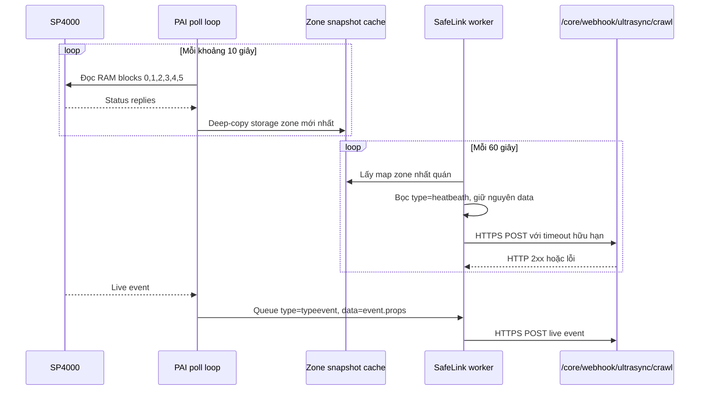

# Hướng dẫn tích hợp Paradox SP4000 → Orange Pi Zero 3 → PAI → SafeLink

## 1. Mục tiêu và kết luận triển khai

Mục tiêu của hệ thống:

1. Orange Pi Zero 3 kết nối với cổng serial của tủ Paradox SP4000 qua USB-TTL, hoặc qua UART5 GPIO có mạch chuyển mức an toàn.
2. PAI nhận byte từ tủ, tách frame, kiểm tra checksum, nhận diện đúng SP4000 và đăng nhập bằng PC Password.
3. PAI đọc cấu hình zone và tên zone từ EEPROM của tủ.
4. PAI đọc trạng thái hiện tại của toàn bộ zone đang được cấu hình, đồng thời nhận live event để cập nhật nhanh.
5. Cứ 60 giây tạo một snapshot đầy đủ và `POST` lên:

   ```text
   https://safelinksystem.app/core/webhook/ultrasync/crawl
   ```

> Domain đúng là `safelinksystem.app`. Domain `safelinkssytem.app` trong yêu cầu ban đầu bị đảo chữ `system` và hiện không có DNS.

Kiến trúc khuyến nghị:

```mermaid
flowchart LR
    Z["Cảm biến / zone"] --> P["Paradox SP4000"]
    P -->|"Serial TTL 5 V, 9600 bps"| L["Bộ chuyển mức hoặc USB-TTL phù hợp 5 V"]
    L -->|"USB /dev/serial/by-id/... hoặc UART5 /dev/ttyS5"| O["Orange Pi Zero 3"]
    O --> S["PAI SerialConnectionProtocol"]
    S --> F["SerialFramer: frame 37 byte + checksum"]
    F --> D["Parser Spectra/Magellan"]
    D --> M["EEPROM definitions + labels"]
    D --> R["RAM status blocks + live events"]
    M --> C["Bộ nhớ trạng thái PAI"]
    R --> C
    C --> B["SafeLinkInterface: REST API + snapshot mới nhất"]
    B -->|"Mỗi 60 giây, HTTPS POST"| W["SafeLink /core/webhook/ultrasync/crawl"]
```



Đây là luồng nên dùng cho bản production đầu tiên. Không nên tự viết lại protocol Paradox trên Orange Pi khi PAI đã có parser, retry, event map, status poll và storage tương ứng với SP/MG.

## 2. Phạm vi kiểm tra và mức độ xác minh

Tài liệu này được tổng hợp từ:

- Toàn bộ tài liệu chữ trong thư mục `docs` của repo này: kiến trúc tổng thể, serial SP/MG, PRT3, serial encryption và arming flow.
- Toàn bộ 17 trang nội dung và `_Sidebar` của [PAI Wiki](https://github.com/ParadoxAlarmInterface/pai/wiki), lấy từ Git repository của Wiki ngày 2026-10-15.
- Code thực tế ở nhánh hiện tại, commit `dc9384bdc0c057d649c5dca55157f638b9721949`.
- Code local hiện tại của `safelink-core-service` cho endpoint `/webhook/ultrasync/crawl`.
- Trang sản phẩm và manual chính thức của Paradox cho SP4000.

Mức độ xác minh:

| Nội dung | Đã xác minh |
|---|---|
| Flow PAI, framing, parser, EEPROM, RAM blocks, storage | Đọc trực tiếp code |
| Danh sách tài liệu Wiki và nội dung serial/MQTT/config | Clone và đọc Wiki |
| SP4000 được PAI map vào Spectra/Magellan | Đọc trực tiếp factory và product ID enum |
| URL đúng của SafeLink | DNS hoạt động; `GET` trả `405`, phù hợp endpoint chỉ nhận `POST` |
| Contract hiện tại của `/crawl` | Đọc controller/entity local của SafeLink |
| Test unit local | 1.712 test pass; gồm test SafeLink và entrypoint `paradosp`. Có 5 test uptime cũ không tương thích Windows do Unix signal; CI Linux không gặp giới hạn này |
| Kết nối Orange Pi Zero 3 ↔ SP4000 thật | Chưa kiểm tra phần cứng |
| PC Password, firmware, số zone và sơ đồ dây thực tế tại hiện trường | Cần xác nhận trên tủ thật |
| `POST` thật lên production | Không thực hiện để tránh tạo dữ liệu ngoài ý muốn |

## 3. Thuật ngữ cần phân biệt

| Thuật ngữ | Ý nghĩa |
|---|---|
| Zone | Một đầu vào/cảm biến của tủ: cửa từ, PIR, báo khói, tamper... |
| `open` | Vòng dây/đầu vào zone đang bị vi phạm. Không đồng nghĩa chắc chắn đang báo động. |
| `alarm` | Zone đang ở trạng thái alarm theo RAM của tủ. |
| `was_in_alarm` | Zone đã từng alarm và còn trong bộ nhớ alarm. Không phải alarm hiện tại. |
| `tamper` | Trạng thái phá hoại/mở nắp/đứt đường tamper. |
| `bypassed` | Zone bị bỏ qua khi arm. Zone bypass vẫn có thể đang `open`. |
| Partition/area | Nhóm zone được arm/disarm cùng nhau. SP4000 hỗ trợ tối đa 2 partition. |
| EEPROM definition | Cấu hình lâu dài của zone: disabled/delay/instant/fire..., partition, bypassable... |
| RAM status | Trạng thái đang xảy ra tại thời điểm poll. |
| Live event | Sự kiện bất đồng bộ do panel tự đẩy ngay khi có thay đổi. |
| Snapshot | Ảnh chụp logic của toàn bộ zone tại một thời điểm, không phải ảnh camera. |

Điểm quan trọng: `open`, `alarm`, `tamper`, `fire` và `bypassed` là các cờ khác nhau. Không được gom tất cả thành một boolean duy nhất rồi làm mất ý nghĩa.

## 4. Phần cứng SP4000 và giới hạn zone

Theo [trang SP4000 chính thức của Paradox](https://www.paradox.com/Products/CAT_SPECTRA/ControlPanels.asp?CATID=6&PRD=1587&SUBCATID=61):

- SP4000 có 4 zone on-board.
- Có thể dùng ATZ để tăng số đầu vào hữu dụng trên bo.
- Có thể mở rộng tới 32 zone bằng module hardwired/wireless phù hợp.
- Hỗ trợ 2 partition và 32 user code.
- Có cổng serial cho IP150/307USB.

PAI dùng chung parser Spectra/Magellan và giải mã bitmap/status cho zone `1..32`. Tuy nhiên, snapshot production chỉ nên coi các zone đã được panel định nghĩa là zone hoạt động. Zone `definition=disabled` không được tự gán thành `closed`.

### 4.1 Cổng serial của panel

[PAI Wiki - Connection methods](https://github.com/ParadoxAlarmInterface/pai/wiki/Connection-methods#serial-connection) mô tả đầu nối:

```text
┌───────┐
│ Rx   ┌╵
│ Tx   │
│ GND  │
│ AUX+ └╷
└───────┘
```

- `RX/TX`: logic TTL 5 V.
- `GND`: mass chung của tín hiệu.
- `AUX+`: 12 V, không phải chân 5 V.
- Serial SP/MG chạy 9600 baud.
- PAI/pyserial mặc định dùng 8 data bit, no parity, 1 stop bit.

### 4.2 Tuyệt đối không nối trực tiếp vào Orange Pi

GPIO UART của Orange Pi là 3,3 V. Không nối trực tiếp tín hiệu 5 V của SP4000 vào GPIO RX Orange Pi. Không nối `AUX+ 12 V` vào chân 5 V/3,3 V của Orange Pi.

Phương án khuyến nghị theo thứ tự:

1. Paradox 307USB nếu đang có sẵn.
2. USB-TTL có logic 5 V thật và được xác nhận datasheet.
3. USB-TTL 3,3 V kết hợp bộ chuyển mức hai chiều phù hợp hoặc mạch cách ly quang được thiết kế đúng.
4. UART GPIO Orange Pi chỉ dùng khi có mạch chuyển mức/cách ly đúng và đã tắt serial console của Linux.

Không dùng bộ chuyển USB-RS232 điện áp chuẩn DB9 ±12 V trực tiếp với cổng TTL của panel. Tên bán hàng “USB RS232 TTL” thường gây nhầm; phải kiểm tra mức điện áp thực tế của chân TX/RX.

### 4.3 Sơ đồ dây tối thiểu

```text
SP4000 TX  ─────────>  RX của USB-TTL / level shifter
SP4000 RX  <─────────  TX của USB-TTL / level shifter
SP4000 GND ──────────  GND tín hiệu của adapter
SP4000 AUX+            KHÔNG NỐI vào Orange Pi

Orange Pi Zero 3 được cấp nguồn riêng, ổn định.
```

Nếu không handshake được, kiểm tra lại hướng TX/RX theo đúng nhãn trên bo thực tế. Chỉ đổi chéo TX/RX sau khi đã chắc chắn mức điện áp an toàn.

### 4.4 Quy tắc vận hành cổng serial

- Cổng serial phải rảnh. Không để BabyWare, 307USB khác, IP150 hoặc một process khác cùng giữ kết nối.
- Dùng tên thiết bị ổn định `/dev/serial/by-id/...`, không phụ thuộc hoàn toàn vào `/dev/ttyUSB0` vì số thứ tự có thể đổi sau reboot.
- User chạy PAI cần quyền đọc/ghi thiết bị, thường qua group `dialout`.
- Dùng nguồn riêng tốt cho Orange Pi, watchdog và UPS nếu đây là hệ thống giám sát 24/7.

### 4.5 Chọn đúng `SERIAL_PORT` trên Orange Pi Zero 3

Có **hai trường hợp khác nhau**, không được thay lẫn nhau:

| Cách nối với SP4000 | `SERIAL_PORT` cần dùng | Ghi chú |
|---|---|---|
| USB-TTL / Paradox 307USB cắm USB | `/dev/serial/by-id/usb-...` | Khuyến nghị. Tên ổn định sau reboot; xem đúng tên bằng `ls -l /dev/serial/by-id/`. |
| Dây vào UART trên header 26 pin của Orange Pi Zero 3 | `/dev/ttyS5` | Đây là UART5. Phải enable UART5 trong OS trước, và không dùng UART0/debug console. |

Vì vậy, `/dev/ttyS1` **không phải** lựa chọn mặc định cho Orange Pi Zero 3. Nếu dùng GPIO UART, đặt API như sau sau khi đã enable UART5:

```json
{
  "CONNECTION_TYPE": "Serial",
  "SERIAL_PORT": "/dev/ttyS5",
  "SERIAL_BAUD": 9600,
  "SERIAL_ENCRYPTED": false,
  "PASSWORD": "0000"
}
```

Kiểm tra node trước khi gọi API:

```bash
ls -l /dev/ttyS5
```

Nếu không tồn tại, enable `uart5` bằng công cụ cấu hình của image đang dùng (Orange Pi OS/Armbian), reboot, rồi kiểm tra lại. Không đoán thành `/dev/ttyS0` vì đó thường là cổng debug/console.

## 5. Cấu hình PAI cho SP4000

Ví dụ `/etc/pai/pai.conf`:

```python
import logging

CONNECTION_TYPE = "Serial"
SERIAL_PORT = "/dev/serial/by-id/usb-REPLACE_WITH_REAL_ADAPTER_ID"
SERIAL_BAUD = 9600
SERIAL_ENCRYPTED = False

# PC Communication Password của BabyWare, không phải master/user/installer code.
PASSWORD = "0000"

# PAI poll trạng thái đầy đủ mỗi 10 giây.
KEEP_ALIVE_INTERVAL = 10
IO_TIMEOUT = 0.5

# Để trống: lúc load definition, PAI tự giữ các zone/PGM đang enabled.
LIMITS = {}

LABEL_ENCODING = "paradox-en"
SYNC_TIME = False

LOGGING_LEVEL_CONSOLE = logging.INFO
LOGGING_DUMP_PACKETS = False
LOGGING_DUMP_MESSAGES = False
LOGGING_DUMP_STATUS = False

# Không bắt buộc nếu dùng SafeLink interface trực tiếp trong PAI.
MQTT_ENABLE = False
```

Lưu ý:

- `PASSWORD` là PC Password 4 ký tự hex trong phần PC Communication của BabyWare.
- Không dùng user code keypad hoặc installer code thay cho PC Password.
- Sai password nhiều lần có thể làm panel lock kết nối trong một khoảng thời gian.
- Với một số firmware, password chứa `0` có thể cần cách encode đặc biệt mà Wiki mô tả, nhưng chỉ thử sau khi đã xác nhận password/baud/wiring đúng.
- `SERIAL_ENCRYPTED=False` là lựa chọn khởi đầu đúng cho SP4000 5.x. Tài liệu `docs/serial_encryption.md` tập trung EVO firmware mới; không tự bật AES cho SP4000 nếu chưa có bằng chứng frame `E0 FE` đúng loại.

## 6. Flow khởi động chi tiết: từ byte serial đến đúng adapter SP4000

### Bước 1 — Start process

```text
pai-service -c /etc/pai/pai.conf
    ↓
paradox.main.main()
    ↓
Paradox() + InterfaceManager
```

### Bước 2 — Mở serial

`Paradox.connection` thấy `CONNECTION_TYPE="Serial"` và tạo:

```text
SerialCommunication(port, baud)
    ↓
serial_asyncio.create_serial_connection()
    ↓
SerialConnectionProtocol
    ↓
SerialFramer
```

Trước khi mở port, code kiểm tra thiết bị có quyền `R_OK | W_OK`.

### Bước 3 — Handshake generic

Lúc đầu PAI chưa biết tủ là EVO hay SP/MG. PAI dùng panel generic để:

1. Gửi `InitiateCommunication`.
2. Nhận model, firmware và serial number.
3. Gửi `StartCommunication`.
4. Đọc `product_id` từ reply.

Trong code, `SPECTRA_SP4000` có product ID `26`. Factory `paradox/hardware/__init__.py` map ID này vào:

```text
paradox.hardware.spectra_magellan.Panel
```

### Bước 4 — Chuyển framing sang SP/MG

Adapter SP/MG được tạo với `variable_message_length=False`. Từ đây `SerialFramer` xử lý frame legacy cố định 37 byte.

Mỗi frame phải qua checksum:

```text
checksum = sum(all_previous_bytes) % 256
```

Nếu checksum sai, framer bỏ một byte để resync thay vì nuốt cả frame kế tiếp.

### Bước 5 — Đăng nhập PC Password

PAI encode password thành 2 byte hex và gửi `InitializeCommunication` command `0x00`. Kết quả chính:

- Reply `0x10`: authentication thành công.
- Close/error `0x70` hoặc `0x00`: authentication thất bại.

Chỉ sau khi authentication thành công, PAI mới load memory và chạy poll status.

### Bước 6 — Load cấu hình zone từ EEPROM

PAI đọc zone definition tại vùng:

```text
0x730 .. <0x7A0, step 0x03, mỗi zone 3 byte
```

Mỗi zone có các trường quan trọng:

- `definition`: disabled, delay, follow, instant, fire, keyswitch...
- `partition`: partition gán cho zone.
- `options.auto_zone_shutdown`.
- `options.bypassable`.
- `options.rf_supervision`.
- `options.alarm_type`.
- `options.intellizone`.
- `options.delay_alarm_transmission`.
- `options.force_arming`.

Zone có `definition != disabled` được coi là enabled. `cfg.LIMITS["zone"]` được giao với danh sách enabled này.

### Bước 7 — Load tên zone

PAI đọc label zone tại:

```text
0x010 .. <0x210, 32 label, mỗi label 16 byte
```

Label được decode theo `LABEL_ENCODING`. PAI tạo metadata kiểu:

```json
{
  "id": 1,
  "label": "Front Door",
  "key": "Front_Door"
}
```

### Bước 8 — Chuyển sang RUN

Sau khi definitions và labels hoàn tất:

```text
run_state = RUN
request_status_refresh()
```

PAI poll ngay, không phải chờ hết 10 giây đầu tiên.

## 7. Flow đọc trạng thái zone

### 7.1 Poll định kỳ

Với SP4000, PAI gửi `ReadEEPROM` vào vùng RAM bắt đầu tại `0x8000`:

```text
request address = 0x8000 + block_id
```

Mỗi reply chứa 32 byte data. Firmware SP4000 5.x poll các block `0,1,2,3,4,5`; block `7` chỉ được poll khi firmware major `>= 6` và chủ yếu chứa PGM status.

`KEEP_ALIVE_INTERVAL=10` nghĩa là chu kỳ poll cố gắng bắt đầu mỗi 10 giây. Đây không phải tần suất push SafeLink. SafeLink vẫn push mỗi 60 giây từ snapshot mới nhất.

### 7.2 Block 0 — open, tamper, fire và system trouble

Các bitmap 4 byte tạo 32 boolean:

- `zone_open[1..32]`
- `zone_tamper[1..32]`
- `zone_fire[1..32]`

Bit thấp nhất của byte đầu là zone 1, bit tiếp theo là zone 2... Adapter dùng:

```text
zone_id = byte_index * 8 + bit_index + 1
value = ((byte >> bit_index) & 1) == 1
```

Block này còn chứa system time, điện áp và trouble tổng của panel.

### 7.3 Block 1 — lỗi RF và partition

- `zone_rf_supervision_trouble[1..32]`
- `zone_rf_low_battery_trouble[1..32]`
- trạng thái 2 partition: alarm, arm, stay/sleep/force, entry/exit delay, ready...

Các cờ RF chỉ có ý nghĩa với zone/module RF tương ứng. Không diễn giải `False` là cảm biến có dây đang “khỏe RF”.

### 7.4 Block 2 — trạng thái chi tiết từng zone

Mỗi zone dùng 1 byte:

| Bit/mask | Field PAI | Ý nghĩa |
|---|---|---|
| `0x80` | `was_in_alarm` | Có alarm trong memory |
| `0x40` | `alarm` | Đang alarm |
| `0x30` | `fire_delay` | Fire delay pattern |
| `0x10` | `entry_delay` | Entry delay |
| `0x08` | `bypassed` | Bị bypass |
| `0x04` | `shutdown` | Zone shutdown |
| `0x02` | `in_tx_delay` | Đang delay transmission |
| `0x01` | `was_bypassed` | Đã từng bypass |

`no_delay` được suy ra khi hai bit `0x30` đều bằng 0.

> Cảnh báo code: biểu thức hiện tại của `intellizone_delay` là `(value & 0x20) == 0x10`, điều kiện này không thể đúng. Không dùng field này cho quyết định nghiệp vụ cho tới khi sửa mask và kiểm tra với frame thật.

### 7.5 Block 3 — signal strength

`zone_signal_strength[1..32]` là số `0..255`. Không tự quy đổi thành dBm hoặc phần trăm nếu chưa có công thức được xác nhận cho model/module RF thực tế.

### 7.6 Block 5 — exit delay theo zone

Bitmap `zone_exit_delay[1..32]` được normalize thành `zone[id].exit_delay`.

### 7.7 Normalize dữ liệu

Các root key phẳng được đổi thành cấu trúc theo element:

```text
zone_open[1]                  → status["zone"][1]["open"]
zone_tamper[1]                → status["zone"][1]["tamper"]
zone_status[1]["alarm"]      → status["zone"][1]["alarm"]
zone_signal_strength[1]       → status["zone"][1]["signal_strength"]
zone_exit_delay[1]            → status["zone"][1]["exit_delay"]
```

Sau đó flow là:

```text
RAM block replies
  → deep_merge
  → convert_raw_status()
  → áp dụng LIMITS
  → ps.sendMessage("status_update")
  → MemoryStorage.update_container_object()
  → Change / ChangeEvent
  → interface bên ngoài
```

## 8. Live event và lý do vẫn cần poll

SP4000 có thể gửi frame live event command nibble `0xE` bất kỳ lúc nào. Event chứa:

- thời gian panel;
- `major` event code;
- `minor` thường là zone/user/object liên quan;
- partition;
- module serial;
- label.

Ví dụ các event major quan trọng trong map SP/MG:

| Major | Ý nghĩa |
|---:|---|
| 0 | Zone OK |
| 1 | Zone open |
| 35 | Zone bypass toggled |
| 36 | Zone in alarm |
| 37 | Zone fire alarm |
| 38 | Zone alarm restore |
| 39 | Fire alarm restore |
| 42 | Zone tamper |
| 43 | Zone tamper restore |

Live event giúp giảm latency, nhưng không được dùng làm nguồn duy nhất vì:

- Có thể mất byte/frame khi serial nhiễu hoặc process restart.
- Event là delta, không phải snapshot đầy đủ.
- Sau reconnect cần poll để tái tạo trạng thái thật.

Thiết kế đúng là: live event để phản ứng nhanh, RAM poll để đối soát và phục hồi trạng thái.

## 9. Ví dụ đầy đủ với zone cửa chính

Giả sử zone 1 tên `Front Door`, thuộc partition 1:

1. Khi PAI khởi động, EEPROM trả definition và label của zone 1.
2. RAM block 0 trả bit `zone_open[1]=False`.
3. RAM block 2 trả `alarm=False`, `bypassed=False`, `was_in_alarm=False`.
4. Snapshot ghi zone 1 là `normal`.
5. Người dùng mở cửa khi tủ đang disarm:
   - panel có thể đẩy live event `Zone open`;
   - lần poll tiếp theo xác nhận `open=True`;
   - `alarm` vẫn có thể `False` vì mở cửa không đồng nghĩa alarm.
6. Nếu partition đang arm và điều kiện alarm xảy ra:
   - `alarm=True`;
   - `was_in_alarm=True` có thể được giữ lại sau đó cho tới khi memory được clear.
7. Khi cửa đóng lại, `open=False`; không được tự xóa `was_in_alarm` nếu panel vẫn giữ memory.

## 10. Contract webhook đã triển khai

Code không normalize, không đổi tên field và không chèn thêm field vào bên trong `data`. Nó chỉ bọc dữ liệu gốc bằng đúng hai khóa ngoài cùng:

```json
{"type": "<loại bản tin>", "data": "<dữ liệu gốc của PAI>"}
```

### 10.1 Heartbeat toàn bộ zone

Ngay khi PAI nhận full status đầu tiên, interface gửi một heartbeat; sau đó cứ
60 giây gửi lại:

```json
{
  "type": "heatbeath",
  "data": {
    "1": {
      "id": 1,
      "key": "Front_Door",
      "label": "Front Door",
      "definition": "delay_1",
      "partition": 1,
      "open": false,
      "alarm": false,
      "tamper": false,
      "bypassed": false
    }
  }
}
```

`data` chính là map `storage.data["zone"]` hiện tại của PAI. Interface không chuyển map thành array, không tự tạo `status`, không lọc zone disabled và không làm mất các boolean gốc. Khi encode JSON, key số của dictionary như `1` hiển nhiên trở thành chuỗi `"1"` theo chuẩn JSON; object zone bên trong không bị đổi form.

Literal `heatbeath` được giữ đúng theo contract đã yêu cầu, dù khác chính tả tiếng Anh thông thường. Giá trị này là hằng số nội bộ trong `safelink.py`, không cần cấu hình vận hành.

### 10.2 Live event

Ngay khi topic nội bộ `events` phát một event, interface đưa bản tin vào queue HTTP:

```json
{
  "type": "typeevent",
  "data": {
    "timestamp": "2026-10-16T08:30:00",
    "level": "INFO",
    "type": "zone",
    "id": 1,
    "label": "Front Door",
    "change": {"open": true},
    "tags": ["live", "zone"]
  }
}
```

`data` là nguyên `event.props`. Ví dụ trên chỉ minh họa; field thực tế phụ thuộc
event mà parser SP/MG tạo ra. Riêng các mẫu điện áp định kỳ mức `DEBUG` có
`property` là `battery`, `dc` hoặc `vdc` và tag `voltage` bị lọc trước queue để
không tạo dữ liệu rác. Các event nguồn/battery dạng trouble mức `CRITICAL` vẫn
được gửi bình thường.

## 11. SafeLink interface và REST API đã triển khai

Code nằm tại `paradox/interfaces/safelink.py`. `InterfaceManager` tự khởi tạo interface khi `SAFELINK_CRAWL_URL` có giá trị; không cần cờ enable riêng.

Luồng runtime:



HTTP outbound chạy trong thread `SafeLinkPush`, không chạy trên asyncio/serial loop. Vì vậy timeout hoặc mất Internet không chặn việc đọc frame SP4000. Queue live event mặc định chứa tối đa 256 phần tử; số event bị bỏ do queue đầy được công khai trong health API.

### 11.1 Bật interface

Toàn bộ phần SafeLink trong `/etc/pai/pai.conf` chỉ cần đúng một dòng:

```python
SAFELINK_CRAWL_URL = "https://safelinksystem.app/core/webhook/ultrasync/crawl"
```

Các giá trị cố định trong code là: API `0.0.0.0:8082`, heartbeat 60 giây, connect/read timeout 5/10 giây, ba lần retry, queue 256 event, type `heatbeath` và `typeevent`.

API không yêu cầu token và trả password rõ theo yêu cầu triển khai. Vì API bind toàn bộ interface mạng, chỉ dùng trong LAN tin cậy và phải chặn port 8082 từ Internet bằng firewall.

Khi serial adapter chưa cắm, đang bận hoặc đường dẫn `SERIAL_PORT` chưa đúng, service vẫn giữ API `8082` hoạt động. PAI chỉ log lỗi và retry kết nối serial; dùng Postman gọi `Update Serial Config` để thay port/baud/password mà không cần restart service.

### 11.2 API nhập cấu hình serial

Endpoint nhận cả `PUT` và `POST`:

```text
PUT /api/v1/config/serial
Content-Type: application/json
```

Ví dụ:

```bash
curl -X PUT http://127.0.0.1:8082/api/v1/config/serial \
  -H 'Content-Type: application/json' \
  -d '{
    "CONNECTION_TYPE": "Serial",
    "SERIAL_PORT": "/dev/serial/by-id/usb-REPLACE_WITH_REAL_ADAPTER_ID",
    "SERIAL_BAUD": 9600,
    "SERIAL_ENCRYPTED": false,
    "PASSWORD": "0000"
  }'
```

API kiểm tra đủ và đúng type của cả năm field, từ chối field lạ, yêu cầu `PASSWORD` đúng 4 ký tự hex. Khi hợp lệ:

1. Ghi atomically vào `~/.pai/safelink-serial.json`, trong đó `~` là home của user chạy PAI.
2. Đặt mode file `0666` và trả `PASSWORD` nguyên văn trong response theo yêu cầu.
3. Ngắt transport cũ trên asyncio loop.
4. Xóa object connection/panel/storage cũ.
5. Main loop PAI tự reconnect bằng port/baud/password mới và đọc lại toàn bộ EEPROM/RAM.

Response là HTTP `202 Accepted` vì reconnect diễn ra bất đồng bộ.

### 11.3 API đọc thông tin tủ

| Method | Endpoint | Kết quả |
|---|---|---|
| `GET` | `/api/v1/panel` | Panel detect, run state, thời điểm status cuối, cấu hình kết nối gồm password rõ và toàn bộ `storage.data` |
| `GET` | `/api/v1/zones` | Nguyên map toàn bộ zone hiện tại; đây cũng là `data` của heartbeat |
| `GET` | `/api/v1/config/serial` | Cấu hình serial hiện tại, gồm password rõ |
| `GET` | `/api/v1/health` | Panel/zone availability, lần heartbeat/event cuối, counter heartbeat/event, lỗi push, queue, filtered và dropped event |

Ví dụ lấy toàn bộ tủ:

```bash
curl http://127.0.0.1:8082/api/v1/panel
```

Collection import trực tiếp vào Postman nằm tại `docs/postman/PAI-SafeLink.postman_collection.json`. Đổi collection variable `base_url` thành IP Orange Pi, ví dụ `http://192.168.1.50:8082`.

Field `data` trong response `/api/v1/panel` gồm các container PAI hiện có như `zone`, `partition`, `system`, `pgm`, `module`... tùy model/cấu hình panel. Trước full status đầu tiên, `/api/v1/zones` trả `available=false`; heartbeat chưa được gửi để tránh tạo trạng thái zone rỗng giả.

### 11.4 Retry và tính không chặn

Mỗi HTTP POST dùng connect/read timeout riêng, mặc định 5/10 giây. Khi lỗi, worker retry tối đa ba lần với backoff 1, 2, 4 giây. Callback serial chỉ deep-copy/queue dữ liệu, tuyệt đối không gọi HTTP.

Giới hạn hiện tại cần hiểu rõ:

1. Live event nằm trong RAM queue, chưa có durable disk spool. Nếu Orange Pi mất điện hoặc process chết trước khi gửi thì event chưa gửi có thể mất; heartbeat sau đó vẫn đối soát trạng thái hiện tại.
2. Queue đầy sẽ không block serial loop mà bỏ event mới, tăng `dropped_events` và log lỗi.
3. Backend `/crawl` vẫn cần tự xử lý idempotency/retention và xác thực token.

## 12. Trạng thái thật của endpoint SafeLink hiện tại

Code local hiện tại:

```java
@RequestMapping("/webhook/ultrasync")
...
@PostMapping("/crawl")
public void receivedInstallerCode(@RequestBody Object obj) {
    CrawlEntity crawlEntity = new CrawlEntity();
    crawlEntity.setId(generateId());
    crawlEntity.setData(StringCommon.writeAsString(obj));
    crawlRepository.save(crawlEntity);
}
```

Với `server.servlet.context-path=/core`, URL đầy đủ là:

```text
POST https://safelinksystem.app/core/webhook/ultrasync/crawl
Content-Type: application/json
```

Các giới hạn phải xử lý trước production:

1. `/crawl` hiện chỉ lưu raw JSON vào bảng `nxg8_crawl`; nó không parse hoặc upsert zone state cho UI.
2. `/event` có kiểm tra `x-token`, nhưng `/crawl` hiện không có kiểm tra token.
3. Security config cho phép `/webhook/ultrasync/**`; vì vậy `/crawl` hiện có thể bị ghi dữ liệu rác từ Internet.
4. Entity khai báo `String data` nhưng source không có migration/DDL của `nxg8_crawl`; chưa chứng minh cột đủ chứa JSON 32 zone. Cần xác nhận là `TEXT` hoặc `JSONB`, không phải `VARCHAR(255)`.
5. Endpoint tạo row mới cho mọi lần POST, không có idempotency và retention.
6. Một Orange Pi gửi mỗi phút tạo 1.440 row/ngày, khoảng 525.600 row/năm. N thiết bị nhân N lần.
7. Method name/log hiện ghi “installer code”, không đúng semantics zone snapshot.
8. Controller log toàn bộ JSON ở mức `INFO`; label zone và trạng thái an ninh có thể đi vào log, làm tăng dung lượng và rủi ro lộ dữ liệu.
9. Response hiện là `void`; HTTP 2xx chỉ chứng minh row đã được lưu, không chứng minh dữ liệu đã được parse hoặc cập nhật vào trạng thái vận hành của SafeLink.

Điều kiện tối thiểu cần chốt ở backend:

- Áp dụng `x-token` hoặc chữ ký HMAC cho `/crawl`.
- Cột payload là `JSONB`/`TEXT` đủ lớn.
- Có index theo panel serial, `type`, thời điểm nhận hoặc cột được parse riêng.
- Có retention hoặc bảng “latest snapshot” upsert theo panel/device đã xác thực.
- Nếu SafeLink UI cần trạng thái zone: thêm parser/upsert, không chỉ archive raw JSON.
- Trả response JSON rõ ràng gồm `accepted` và `server_time`.
- Nếu cần idempotency, backend phải sinh khóa/hash mà không yêu cầu đổi form `data` hiện tại.

Không đưa token mặc định hoặc credential thật vào tài liệu, repo hay log.

## 13. Cài PAI trên Orange Pi Zero 3

### 13.1 Cách gọn nhất: `paradosp` + một file setup

Workflow `.github/workflows/build-paradosp-arm64.yml` chạy trên runner `ubuntu-22.04-arm`, dùng PEX `--scie eager` để tạo **native ELF ARM64 tên `paradosp` có nhúng sẵn CPython và toàn bộ dependency**. Đây không phải Nuitka và không mã hóa/che source. Orange Pi không cần có Python, pip, virtualenv, compiler hoặc Internet khi chạy.

CI kiểm tra file là ELF ARM64 rồi chạy self-test trong môi trường đã xóa `PATH`, nhờ vậy build sẽ fail nếu chương trình còn phụ thuộc Python cài trên runner.

Sau khi tải artifact, chỉ copy hai file vào cùng thư mục bất kỳ trên Orange Pi:

```text
paradosp
setup-orange-pi.sh
```

Cài đặt bằng đúng một lệnh:

```bash
sudo sh setup-orange-pi.sh ./paradosp
```

Không cần tự `chmod`, cài Python hay sửa quyền serial. Script tự:

1. Kiểm tra OS là ARM64 (`aarch64`).
2. Cài chương trình vào `/opt/paradosp/paradosp`.
3. Tạo `/etc/paradosp/paradosp.conf` mode `0600`, cấu hình sẵn `/dev/ttyS1`,
   9600 baud, không mã hóa, password mặc định `0000` và URL SafeLink.
4. Tạo log `/var/log/paradosp/paradosp.log`, xoay theo ngày, nén gzip và giữ
   30 bản cũ.
5. Tạo `paradosp.service`, chạy bằng root và tự khởi động lại nếu lỗi.
6. Chạy `--self-test`, enable service và khởi động ngay.

Nếu PC Communication Password của tủ là `0000`, không cần API/Postman. Nếu
khác, sửa `PASSWORD` trong `/etc/paradosp/paradosp.conf` rồi restart service.
Cấu hình đã từng lưu bằng API tại
`/var/lib/paradosp/.pai/safelink-serial.json` vẫn được ưu tiên để không phá máy
đang vận hành.

### 13.2 Cách cài từ source để debug

Ví dụ Debian/Ubuntu/Armbian:

```bash
sudo apt update
sudo apt install -y python3 python3-venv python3-pip git

sudo mkdir -p /opt/pai /etc/pai /var/log/pai
sudo chown -R "$USER":"$USER" /opt/pai

git clone https://github.com/ParadoxAlarmInterface/pai.git /opt/pai/src
python3 -m venv /opt/pai/venv
/opt/pai/venv/bin/python -m pip install --upgrade pip
/opt/pai/venv/bin/python -m pip install -e /opt/pai/src
```

Repo hiện yêu cầu Python `>=3.8` và khai báo hỗ trợ 3.8–3.14. Wiki Manual còn nhắc Python 3.6/3.7, phần đó đã cũ so với `pyproject.toml` hiện tại.

Tìm serial ổn định:

```bash
ls -l /dev/serial/by-id/
udevadm info --query=property --name=/dev/ttyUSB0
```

Thêm user service vào `dialout`, sau đó đăng xuất/đăng nhập hoặc reboot:

```bash
sudo usermod -aG dialout pai
```

Nếu cài bằng `setup-orange-pi.sh`, service chạy trực tiếp `/opt/paradosp/paradosp --config /etc/paradosp/paradosp.conf`, không gọi Python hệ thống.

## 14. Checklist kiểm thử hiện trường

### 14.1 Điện và dây

- [ ] Đã đo/xác nhận chân `AUX+` là 12 V và không nối vào Orange Pi.
- [ ] Adapter nhận đúng TTL 5 V, không phải RS232 ±12 V.
- [ ] Panel TX → adapter RX, panel RX ← adapter TX, GND chung.
- [ ] Orange Pi dùng nguồn riêng ổn định.
- [ ] Không có thiết bị/process khác chiếm serial.

### 14.2 Kết nối PAI

- [ ] Serial device tồn tại ở `/dev/serial/by-id/...`.
- [ ] User PAI có read/write permission.
- [ ] Log có `Serial port open`.
- [ ] Log detect đúng `SP4000`, firmware và serial number.
- [ ] Log có `Authentication Success`.
- [ ] Definitions và labels được load.
- [ ] `run_state=RUN` và status poll tiếp tục đều.

### 14.3 Mapping zone

Kiểm tra từng zone vật lý, không chỉ zone 1:

1. Ghi zone ID/label/partition từ BabyWare hoặc keypad.
2. Mở/đóng từng cửa hoặc kích PIR.
3. Xác nhận đúng zone chuyển `open false → true → false`.
4. Kiểm tra tamper riêng.
5. Kiểm tra bypass riêng.
6. Chỉ test alarm/fire theo quy trình an toàn, có người phụ trách tủ và đã cô lập đường báo trung tâm nếu cần.
7. Xác nhận không lệch `zone_id` ±1.

### 14.4 Snapshot 60 giây

- [ ] Snapshot đầu tiên chỉ gửi sau full status đầu tiên.
- [ ] Snapshot đầu tiên được gửi ngay, các snapshot sau cách nhau 60 giây.
- [ ] Outer payload chỉ có `type` và `data`; `type` đúng literal `heatbeath`.
- [ ] `data` đúng bằng map trả bởi `GET /api/v1/zones`, không normalize/đổi tên field.
- [ ] Mỗi payload chứa toàn bộ zone PAI đang giữ, kể cả definition/label/status hiện có.
- [ ] Live event dùng `type=typeevent` và `data=event.props` nguyên dạng.
- [ ] Telemetry `battery`/`dc`/`vdc` mức DEBUG không tạo `typeevent`; trouble
      nguồn mức CRITICAL vẫn tạo event.
- [ ] Mất serial không tạo hàng loạt zone `normal` giả.
- [ ] Mất Internet không block poll serial.
- [ ] Sau phục hồi mạng heartbeat dùng trạng thái zone mới nhất, không xếp hàng các heartbeat cũ.
- [ ] Backend nhận payload lớn hơn trường hợp 32 zone.
- [ ] Port API 8082 chỉ mở trong LAN/firewall vì API không có token và trả password rõ.
- [ ] `GET /api/v1/health` không tăng `dropped_events` trong soak test.
- [ ] `heartbeat_push_count` tăng và `last_heartbeat_at` được cập nhật.

### 14.5 Soak test

Chạy tối thiểu 24–72 giờ và đo:

- số lần reconnect serial;
- checksum/framing error;
- số status poll timeout;
- tuổi dữ liệu lớn nhất;
- HTTP latency p50/p95/p99;
- số POST lỗi/retry;
- CPU, RAM và dung lượng log;
- tốc độ tăng bảng `nxg8_crawl`.

## 15. Các sai khác giữa Wiki và code hiện tại

Khi có xung đột, tài liệu này ưu tiên code ở commit đã nêu:

1. Wiki MQTT có chỗ ghi raw event ở `paradox/states/raw`; code hiện tại publish `paradox/events/raw`.
2. Wiki dùng tên `KEEP_ALIVE_INTERFACE`; config/code hiện tại dùng `KEEP_ALIVE_INTERVAL`.
3. Wiki cũ nói Python 3.6+; `pyproject.toml` hiện yêu cầu Python 3.8+.
4. Wiki nói event 37 byte ở 9600 baud mất khoảng 500 µs. Với 8N1, 37 byte cần xấp xỉ `37 × 10 / 9600 = 38,5 ms`, chưa tính khoảng nghỉ và xử lý.
5. Wiki hiện chưa phản ánh đầy đủ PRT3 và serial encryption mới có trong nhánh repo này; hai phần đó không phải đường chính cho SP4000 5.x.

## 16. Kết luận production

Luồng đúng cho bài toán này là:

```text
SP4000
→ TTL 5 V an toàn
→ USB serial ổn định trên Orange Pi Zero 3
→ PAI handshake + PC Password
→ đọc EEPROM để biết zone nào tồn tại và tên/definition của zone
→ poll RAM 10 giây để có full state
+ live event để giảm latency
→ cache snapshot đầy đủ
→ worker HTTP độc lập push mỗi 60 giây
→ SafeLink xác thực, lưu JSON đủ lớn và upsert/retention đúng mục đích
```

Không nên triển khai production cho tới khi hoàn tất ba việc:

1. Xác nhận phần cứng/điện áp và mapping từng zone trên SP4000 thật.
2. Sửa/hoàn thiện contract backend `/crawl`: auth, payload size, parse/upsert, idempotency và retention.
3. Chạy soak test 24–72 giờ, chứng minh mất serial/mạng không làm phát sinh trạng thái `normal` giả.

## 17. Nguồn tham khảo chính

- [PAI README](https://github.com/ParadoxAlarmInterface/pai)
- [PAI Wiki](https://github.com/ParadoxAlarmInterface/pai/wiki)
- [Connection methods](https://github.com/ParadoxAlarmInterface/pai/wiki/Connection-methods)
- [Compatibility](https://github.com/ParadoxAlarmInterface/pai/wiki/Compatibility)
- [Configuration](https://github.com/ParadoxAlarmInterface/pai/wiki/Configuration)
- [MQTT Interface](https://github.com/ParadoxAlarmInterface/pai/wiki/MQTT-Interface)
- [FAQ](https://github.com/ParadoxAlarmInterface/pai/wiki/FAQ)
- [Paradox SP4000 product page](https://www.paradox.com/Products/CAT_SPECTRA/ControlPanels.asp?CATID=6&PRD=1587&SUBCATID=61)
- [Paradox MG/SP Reference & Installation Guide](https://www.paradox.com/Firmware/MGSP_Installation_Guide_Rev_16.pdf)
- Code chính trong repo: `paradox/paradox.py`, `paradox/connections/serial/*`, `paradox/hardware/spectra_magellan/*`, `paradox/parsers/status.py`, `paradox/data/*`.

