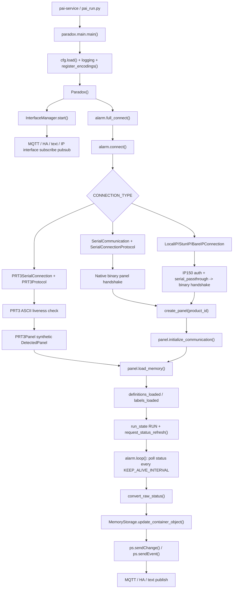
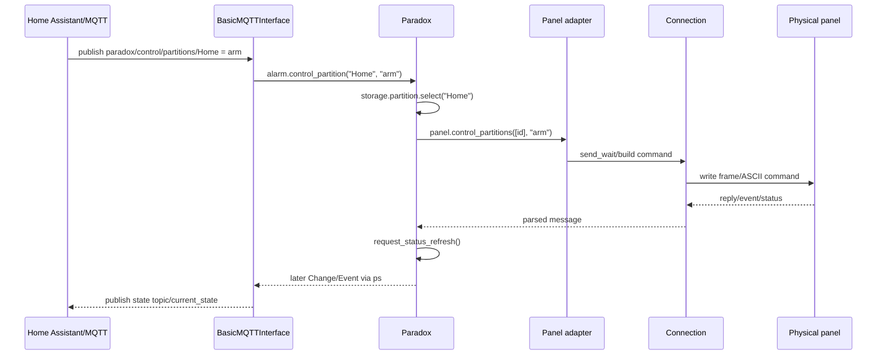

# Phan tich chi tiet thu muc PAI

Tai lieu nay duoc viet sau khi doc truc tiep code trong thu muc `C:\Users\HoangSon\IdeaProjects\pai`. Repo nay la **PAI - Paradox Alarm Interface**, mot middleware Python de ket noi voi tu bao dong Paradox, doc trang thai panel, nhan event, dieu khien partition/zone/output va publish sang MQTT/Home Assistant/text/IP interface.

Luu y thuat ngu trong repo:

- **Panel / tu**: bo dieu khien bao dong Paradox, vi du EVO48, EVO96, EVO192, EVOHD, Spectra SP, Magellan MG.
- **Partition / area**: phan vung bao dong.
- **Zone**: vung/cam bien dau vao.
- **PGM/output**: ngo ra dieu khien.
- **IP150/IP100**: module IP cua Paradox.
- **PRT3**: printer module cua Paradox, noi bang serial ASCII, khac voi native binary serial.

## 1. Muc dich he thong

PAI dung de:

1. Ket noi toi panel Paradox qua `Serial`, `IP` hoac `PRT3`.
2. Xac thuc voi module/panel neu giao thuc can.
3. Detect loai panel va tao adapter hardware tuong ung.
4. Load label/definition tu panel memory hoac tu PRT3 ASCII command.
5. Poll trang thai theo chu ky.
6. Nhan event bat dong bo tu panel.
7. Chuan hoa tat ca vao `MemoryStorage`.
8. Phat thay doi/event qua pub-sub noi bo.
9. Xuat ra MQTT, Home Assistant discovery, text notification, GSM/Signal/Pushbullet/Pushover, hoac IP socket interface.
10. Nhan command tu MQTT/text/IP interface va gui nguoc ve panel.

Repo khong phai AI/CV. Day la code tich hop alarm panel/IoT, trong do phan quan trong nhat la do tin cay ket noi, parser frame, trang thai partition/zone, MQTT command va Home Assistant discovery.

## 2. Cach chay nhanh

### Cai package

Project la Python package `paradox-alarm-interface`, cau hinh trong `pyproject.toml`.

```bash
pip install -r requirements.txt
pip install .
```

Console script sau khi install:

```bash
pai-service -c /path/to/pai.conf
pai-dump-memory --ram -f ram.bin -c /path/to/pai.conf
pai-dump-memory --eeprom -f eeprom.bin -c /path/to/pai.conf
ip150-connection-decrypt ...
```

Chay truc tiep trong repo:

```bash
python -m paradox.console_scripts.pai_run -c config/pai.conf.example
```

`run.sh` chi la wrapper:

```bash
python3 -m paradox.console_scripts.pai_run "$@"
```

### Config

File mau: `config/pai.conf.example`.

Mac dinh loader tim config theo thu tu:

1. tham so `-c/--config`,
2. env `PAI_CONFIG_FILE`,
3. `pai.conf`, `pai.json`, `pai.yaml` trong current working directory,
4. `~/.local/etc`,
5. `/etc/pai`,
6. `/usr/local/etc/pai`.

Env override dung prefix `PAI_`, vi du `PAI_MQTT_ENABLE=True`, `PAI_CONFIG_FILE=/etc/pai/pai.conf`.

Config toi thieu can quan tam:

```python
CONNECTION_TYPE = "Serial"  # "Serial", "IP", hoac "PRT3"
PASSWORD = "0000"           # PC password neu panel yeu cau

SERIAL_PORT = "/dev/ttyS1"
SERIAL_BAUD = 9600

MQTT_ENABLE = True
MQTT_HOST = "127.0.0.1"
MQTT_PORT = 1883
```

Voi IP150:

```python
CONNECTION_TYPE = "IP"
IP_CONNECTION_HOST = "192.168.1.50"
IP_CONNECTION_PORT = 10000
IP_CONNECTION_PASSWORD = "paradox"
```

Voi PRT3:

```python
CONNECTION_TYPE = "PRT3"
PRT3_SERIAL_PORT = "/dev/ttyUSB0"
PRT3_SERIAL_BAUD = 9600
PRT3_USER_CODE = "1234"     # bat buoc de disarm; empty thi chi quick-arm
PRT3_MAX_AREAS = 2
PRT3_MAX_ZONES = 32
PRT3_MAX_USERS = 32
```

### Docker

`Dockerfile` dung `python:3.14-alpine`, copy `config/pai.conf.example` vao `/etc/pai/pai.conf`, expose:

- `${PAI_MQTT_BIND_PORT}/tcp`, mac dinh env la `18839`.
- `10000/tcp` cho IP interface.

Container chay command `pai-service`.

## 3. Cau truc thu muc

```text
pai/
  paradox/
    main.py                         Runtime entrypoint
    paradox.py                      Core orchestration: connect, loop, storage, control, event
    config.py                       Default config, load config, env override, validation
    event.py                        Event, LiveEvent, ChangeEvent, Notification
    data/                           In-memory model/state containers
    connections/                    Transport, protocol, framing
      serial/                       Native serial binary protocol
      ip/                           IP150/IP100 wrapper and STUN/SWAN
      prt3/                         PRT3 serial ASCII protocol
      gsm/                          GSM modem serial transport
    hardware/                       Panel adapters and protocol parsers
      evo/                          EVO family
      spectra_magellan/             Spectra/Magellan family
      prt3/                         PRT3 hardware adapter
    interfaces/                     MQTT, Home Assistant, IP socket, text interfaces
    lib/                            Pubsub, handlers, crypto, utils, encodings
    parsers/                        Shared status conversion
    console_scripts/                CLI entrypoints
  config/                           Config example and MQTT Dash template
  docs/                             Architecture/usage docs
  tests/                            Unit/integration tests
  pyproject.toml                    Packaging and dependencies
  tox.ini                           Test matrix py38-py314
  Dockerfile                        Container runtime
```

## 4. Flow tong the



### Thu tu runtime chi tiet

1. `paradox.console_scripts.pai_run.main()` parse `-c/--config`.
2. `paradox.main.main(args)` load config va setup logger.
3. `register_encodings()` dang ky cac encoding `paradox-*` de decode label panel.
4. Tao `Paradox()` va chay `asyncio.run(_run(Paradox()))`.
5. `_run()` tao `InterfaceManager`, start cac interface da enable.
6. `_run()` lap reconnect:
   - goi `alarm.full_connect()`;
   - neu connect OK thi `alarm.loop()`;
   - neu mat ket noi/exception thi sleep retry toi da 30 giay va reconnect;
   - gap `PAICriticalException` thi dung.
7. `full_connect()` goi `connect()`, `panel.load_memory()`, `_init_module_pgms()`, set `RunState.RUN`, trigger status refresh.
8. `loop()` poll status theo `KEEP_ALIVE_INTERVAL`, mac dinh 10 giay.
9. Neu status request mat reply qua 3 lan lien tiep, code disconnect va reconnect.

## 5. Cac loai ket noi

### 5.1 Serial native

Config:

```python
CONNECTION_TYPE = "Serial"
SERIAL_PORT = "/dev/ttyS1"
SERIAL_BAUD = 9600
SERIAL_ENCRYPTED = False
PASSWORD = "0000"
```

File chinh:

- `paradox/connections/serial/connection.py`
- `paradox/connections/serial/protocol.py`
- `paradox/connections/serial/framing.py`
- `paradox/connections/serial/encryption.py`

Nguyen ly:

1. `SerialCommunication.connect()` mo serial port bang `serial_asyncio.create_serial_connection()`.
2. Neu port khong readable/writable thi fail nhanh.
3. `SerialConnectionProtocol.data_received()` dua bytes vao `SerialFramer`.
4. `SerialFramer` tach stream thanh frame Paradox binary theo nibble dau, length byte, checksum.
5. Neu `SERIAL_ENCRYPTED=True` va co `PASSWORD`, protocol wrap transport bang `EncryptedSerialTransport`.
6. Incoming encrypted `E0 FE` frame duoc scan theo AES block boundary, decrypt bang `decrypt_serial_message()`.
7. Frame sau khi hop le duoc day vao `connection.on_message()`, roi `Paradox.on_connection_message()`.

San xuat/van hanh:

- Serial native can dung baud theo panel: MG/SP thuong 9600; EVO co the 38400/57600; plus versions co the 115200.
- `SERIAL_ENCRYPTED=True` dung cho EVO firmware moi co E0 FE AES serial. Neu bat flag nhung khong co `PASSWORD`, code log error va disable encryption.
- Framer co gioi han length de tranh corrupt byte lam buffer doi vo han.

### 5.2 IP150/IP100

Config:

```python
CONNECTION_TYPE = "IP"
IP_CONNECTION_HOST = "127.0.0.1"
IP_CONNECTION_PORT = 10000
IP_CONNECTION_PASSWORD = "paradox"
IP_CONNECTION_SITEID = None
IP_CONNECTION_EMAIL = None
IP_CONNECTION_BARE = False
```

File chinh:

- `paradox/connections/ip/connection.py`
- `paradox/connections/ip/protocol.py`
- `paradox/connections/ip/framing.py`
- `paradox/connections/ip/parsers.py`
- `paradox/connections/ip/commands.py`
- `paradox/connections/ip/stun_session.py`

Co 3 mode:

- `LocalIPConnection`: ket noi truc tiep IP150/IP100 bang host/port/password.
- `StunIPConnection`: ket noi qua SITE ID + email, dung SWAN/STUN session.
- `BareIPConnection`: TCP endpoint la serial-over-TCP tunnel, khong co IP150 auth; dung `SerialConnectionProtocol` tren socket.

Handshake IP150:

1. TCP connect.
2. `IPModuleConnectCommand.execute()`.
3. Gui connect/auth command `0xF0` voi IP module password.
4. Nhan `IPPayloadConnectResponse`.
5. Neu `login_status != success`:
   - `invalid_password` -> `PAICriticalException`.
   - status khac -> `ConnectToIpModuleFailed`.
6. Lay key moi tu response.
7. Gui keep alive `0xF2`.
8. Gui upload/download connection `0xF3`.
9. Gui toggle keep alive `0xF8`.
10. Sau do binary panel frame duoc wrap vao IP packet `serial_passthrough_request`.

Diem quan trong:

- IP150 chi la transport wrapper. Payload sau khi unwrap van la binary panel frame, di tiep vao cung `Panel.parse_message()` nhu native serial.
- `IPFramer` yeu cau header `0xAA`, 16-byte aligned, payload padded len multiple of 16.
- `MAX_IP_PAYLOAD=2048` de tranh stream desync.

### 5.3 PRT3

Config:

```python
CONNECTION_TYPE = "PRT3"
PRT3_SERIAL_PORT = "/dev/ttyUSB0"
PRT3_SERIAL_BAUD = 9600   # chi chap nhan 9600 hoac 19200
PRT3_MAX_AREAS = 8
PRT3_MAX_ZONES = 96
PRT3_MAX_USERS = 32
PRT3_USER_CODE = ""
PRT3_COMM_TIMEOUT = 10
PRT3_UTILITY_KEYS = {1: "Lock Front Door"}
```

File chinh:

- `paradox/connections/prt3/connection.py`
- `paradox/connections/prt3/protocol.py`
- `paradox/hardware/prt3/panel.py`
- `paradox/hardware/prt3/parser.py`
- `paradox/hardware/prt3/encoder.py`
- `paradox/hardware/prt3/adapter.py`
- `paradox/hardware/prt3/event.py`
- `paradox/hardware/prt3/property.py`

Khac biet voi Serial/IP:

| Noi dung | Serial/IP native | PRT3 |
|---|---|---|
| Wire format | Binary frame + checksum | ASCII line ket thuc bang `\r` |
| Handshake | `InitiateCommunication` / `StartCommunication` | nghe `COMM&ok` hoac probe `RA001` |
| Detect panel | Doc `product_id` tu panel | Khong detect panel that, tao identity `PRT3` |
| Label | EEPROM read | ASCII `AL`, `ZL`, `UL` |
| Status | RAM block parser | ASCII `RA`, `RZ` |
| Event | Binary live event command `0xE` | ASCII `G{group}N{number}A{area}` |
| Auth | PC password | PRT3 khong auth link; arm/disarm dung user code |

PRT3 liveness:

1. Mo serial port.
2. Nghe spontaneous message trong 2 giay: `COMM&ok`, event, status, label, echo.
3. Neu im lang, gui `RA001\r` probe.
4. Nhan bat ky PRT3 message hop le thi coi link live.
5. `COMM&fail` hoac timeout het `PRT3_COMM_TIMEOUT` thi fail.

PRT3 status:

- Area status request: `RA{nnn}\r`.
- Zone status request: `RZ{nnn}\r`.
- Label request: `AL{nnn}`, `ZL{nnn}`, `UL{nnn}`.
- `adapter.py` doi PRT3 `area` thanh PAI `partition`.
- `not_ready=True` cua PRT3 duoc dao thanh `ready_status=False`.
- `armed_instant` duoc map gan nhat thanh stay arm, vi PAI khong co flag instant rieng.

PRT3 control:

- Arm voi user code: `AA{area}{mode}{code}`.
- Quick arm khong code: `AQ{area}{mode}`, can One-Touch Arming tren panel.
- Disarm: `AD{area}{code}`, bat buoc co `PRT3_USER_CODE`.
- Panic: `PE`, `PM`, `PF`.
- Utility key: `UK{key}`.

Gioi han PRT3:

- Khong co EEPROM read.
- Khong co time sync.
- Khong support zone bypass command.
- Khong support PGM/output control truc tiep.
- Utility key khong idempotent, code co tinh khong retry de tranh double-trigger gate/latch.
- Arm/disarm/panic cung khong retry khi timeout vi echo mat co the gay gui lai lenh nguy hiem.

## 6. Cac loai tu/panel duoc support

Panel native duoc detect qua `product_id` va tao trong `paradox/hardware/__init__.py`.

### EVO family

Class:

- `Panel_EVO48`
- `Panel_EVO96`
- `Panel_EVO192`
- `Panel_EVOHD`

Product IDs:

- `DIGIPLEX_EVO_48`
- `DIGIPLEX_EVO_96`
- `DIGIPLEX_EVO_192`
- `DIGIPLEX_EVO_HD`
- `DIGIPLEX_EVO_HD_PLUS`

File:

- `paradox/hardware/evo/panel.py`
- `paradox/hardware/evo/models/*.py`
- `paradox/hardware/evo/parsers.py`
- `paradox/hardware/evo/event.py`
- `paradox/hardware/evo/property.py`

Dac diem:

- Dung binary protocol.
- `Panel_EVOBase.max_eeprom_response_data_length = 64`.
- `status_request_addresses = parsers.RAMDataParserMap.keys()`.
- Model file khac nhau chu yeu o memory map: label address, definition address, zone/partition/user capacity.
- Ho tro partition control, zone action, PGM, module PGM, door, panic.
- Co parser rieng cho module PGM action.

### Spectra / Magellan family

Class:

- `paradox.hardware.spectra_magellan.panel.Panel`

Product IDs:

- `SPECTRA_SP4000`
- `SPECTRA_SP5500`
- `SPECTRA_SP550_PLUS`
- `SPECTRA_SP6000`
- `SPECTRA_SP6000_PLUS`
- `SPECTRA_SP7000`
- `SPECTRA_SP7000_PLUS`
- `SPECTRA_SP65`
- `MAGELLAN_MG5000`
- `MAGELLAN_MG5050`
- `MAGELLAN_MG5050_PLUS`
- `MAGELLAN_MG5075`

File:

- `paradox/hardware/spectra_magellan/panel.py`
- `paradox/hardware/spectra_magellan/parsers.py`
- `paradox/hardware/spectra_magellan/event.py`
- `paradox/hardware/spectra_magellan/property.py`

Dac diem:

- Binary protocol legacy hon EVO.
- `max_eeprom_response_data_length = 32`.
- Memory map co label zone, PGM, partition, user, module, repeater, keypad, site, siren.
- `supports_pgm_status` phu thuoc firmware version >= 6.
- Control action map bang numeric action: partition, zone, PGM.

### PRT3 adapter

PRT3 khong detect EVO48/EVO192 truc tiep. Runtime tao `DetectedPanel(model="PRT3", firmware_version="N/A", serial_number="prt3_<port>")` de Home Assistant co device identity on dinh.

PRT3 thuong dung de noi voi EVO panel qua combus, nhung tu goc nhin PAI thi no la connection/hardware adapter rieng.

## 7. Core orchestration trong `paradox.py`

`Paradox` la lop trung tam.

Nhung state chinh:

- `panel`: adapter hardware hien tai.
- `_connection`: transport hien tai.
- `storage`: `MemoryStorage`, snapshot state RAM.
- `run_state`: `STOP`, `INIT`, `CONNECTED`, `RUN`, `PAUSE`, `ERROR`.
- `request_lock`: serialize request/response de tranh 2 command tranh cung reply.
- `busy`: bao ve poll/control khi can.
- `loop_wait_event`: trigger poll status som.
- `_partition_arm_freeze_until`: rieng PRT3, chan RA stale sau khi disarm.

### Connection selection

`Paradox.connection` chon transport dua vao config:

- `Serial` -> `SerialCommunication`.
- `IP` + `IP_CONNECTION_BARE=True` -> `BareIPConnection`.
- `IP` + `IP_CONNECTION_SITEID` va `IP_CONNECTION_EMAIL` -> `StunIPConnection`.
- `IP` con lai -> `LocalIPConnection`.
- `PRT3` -> `PRT3SerialConnection`.

Sau khi tao connection, `_register_connection_handlers()` dang ky:

- raw handler `on_connection_message`.
- binary event handler `handle_event_message`.
- error handler `handle_error_message`.
- neu PRT3 thi them `handle_prt3_event_message`.

### Native binary connect flow

1. `connection.connect()`.
2. Tao generic `Panel`.
3. Set framing mode tam thoi theo generic panel.
4. Gui `InitiateCommunication`, doi reply command `0x7`.
5. Lay model, firmware, serial.
6. Gui `StartCommunication`, doi reply command `0x0`.
7. Lay `product_id`.
8. `create_panel(core, reply)` tao panel adapter dung family.
9. Cap nhat `connection.variable_message_length()` theo panel family:
   - EVO variable.
   - SP/Magellan fixed.
10. Publish `panel_detected`.
11. `panel.initialize_communication(cfg.PASSWORD)` login installer/PC password.
12. Set `RunState.CONNECTED`.

### PRT3 connect flow

1. `connection.connect()`.
2. Tao `PRT3Panel(self)`.
3. `PRT3Panel.initialize_communication(None)` kiem tra link live.
4. Tao `DetectedPanel` synthetic.
5. Publish `panel_detected`.
6. Set `RunState.CONNECTED`.

### Load memory

Sau connect:

1. `panel.load_memory()`.
2. `load_definitions()` -> publish `definitions_loaded`.
3. `load_labels()` -> publish `labels_loaded`.
4. `Paradox._on_definitions_load()` va `_on_labels_load()` merge vao `storage`.
5. `_init_module_pgms()` tao synthetic `module_pgm` tu `MODULE_PGM_ADDRESSES`.

PRT3:

- `load_definitions()` tra `{}`.
- `load_labels()` poll `AL/ZL/UL`.

Native:

- `load_definitions()` doc EEPROM definition map.
- `load_labels()` doc EEPROM label map.

### Status loop

`Paradox.loop()` chay khi `run_state == RUN`:

1. Acquire `busy`.
2. Goi `panel.get_status_requests()`.
3. Native panel tao list coroutine `request_status(address)`.
4. PRT3 chi co virtual address `[0]`, ben trong poll all configured areas/zones.
5. `asyncio.gather()` lay raw status.
6. `deep_merge()` gop cac block.
7. `call_soon(self._process_status, merged)`.
8. `_process_status()` goi `convert_raw_status()`.
9. Ap dung `cfg.LIMITS`.
10. Publish `status_update`.
11. `_on_status_update()` update `MemoryStorage`.
12. `_update_partition_states()` tao synthetic `current_state`/`target_state` cho HA.

Mat status:

- Neu `StatusRequestException` hoac timeout, tang `replies_missing`.
- Neu `replies_missing > 3`, log lost communication va disconnect.

## 8. Data model va pub-sub noi bo

### `MemoryStorage`

File:

- `paradox/data/memory_storage.py`
- `paradox/data/element_type_container.py`

Storage la in-memory, khong co database.

Container theo element type:

- `partition`
- `zone`
- `pgm`
- `module_pgm`
- `door`
- `user`
- `module`
- `keypad`
- `repeater`
- `system`
- cac type khac neu parser/event tao ra.

Moi object co the select bang numeric id hoac text key. `ElementTypeContainer` giu them `key_index` de map label key sang object.

Update flow:

1. `storage.update_container_object(container, key, changes)`.
2. Neu object chua co thi tao `{"key": key}`.
3. Voi moi property:
   - bo qua property bat dau bang `_`;
   - neu value la callable thi goi voi old value;
   - neu value khong doi va `PUSH_UPDATE_WITHOUT_CHANGE=False` thi khong notify;
   - tao `Change`.
4. `ps.sendChange(change)`.

### Pub-sub `ps`

File: `paradox/lib/ps.py`.

Topic noi bo co prefix `pai_`, vi du:

- `labels_loaded`
- `definitions_loaded`
- `status_update`
- `events`
- `changes`
- `notifications`
- `panel_detected`
- `run-state`
- `connected`

`ps.sendMessage()` va `ps.sendEvent()` dung `call_soon_in_main_loop()` de dua callback ve main asyncio loop neu duoc goi tu thread interface.

### Event model

File: `paradox/event.py`.

3 class chinh:

- `Change`: thay doi property trong storage.
- `LiveEvent`: event binary truc tiep tu panel, map qua `event_map`.
- `ChangeEvent`: event phat sinh tu `Change`, map qua `property_map`.

Voi binary live event:

1. `handle_event_message()` tao `LiveEvent`.
2. Neu `evt.change` co du lieu va element ton tai, update storage.
3. `ps.sendEvent(evt)`.
4. `_on_event()` co the goi hook va update partition state.

Voi property change:

1. `MemoryStorage` gui `Change`.
2. `Paradox._on_property_change()` tao `ChangeEvent`.
3. `ps.sendEvent(event)` cho interface/text/MQTT.

Voi PRT3 event:

1. `PRT3Protocol` tach line.
2. `PRT3Panel.parse_message()` -> `PRT3SystemEvent`.
3. `handle_prt3_event_message()` -> `PRT3Event.from_prt3()`.
4. `_apply_prt3_event_change()`.
5. `ps.sendEvent(evt)`.

## 9. MQTT interface

File:

- `paradox/interfaces/mqtt/core.py`
- `paradox/interfaces/mqtt/basic.py`
- `paradox/interfaces/mqtt/homeassistant.py`
- `paradox/interfaces/mqtt/entities/*`

### MQTT connection singleton

`MQTTConnection` la singleton dung chung cho Basic MQTT va Home Assistant autodiscovery.

No publish:

- `paradox/interface/pai_status`
- `paradox/interface/availability`

`RunState` map:

- `ERROR` -> `error`
- `INIT` -> `initializing`
- `PAUSE` -> `paused`
- `CONNECTED` -> `connected`
- `RUN` -> `online`
- `STOP` -> `stopped`

Availability la `online` khi status `online` hoac `paused`, con lai `offline`.

### State publish

`BasicMQTTInterface._handle_panel_change()` publish moi change:

```text
{MQTT_BASE_TOPIC}/states/{element_topic}/{key}/{property}
```

Mac dinh:

- partition -> `paradox/states/partitions/<key>/<property>`
- zone -> `paradox/states/zones/<key>/<property>`
- output/pgm/module_pgm -> `paradox/states/outputs/<key>/<property>`
- system -> `paradox/states/system/<key>/<property>`
- user -> `paradox/states/users/<key>/<property>`
- door -> `paradox/states/doors/<key>/<property>`

Neu value la dict, code publish de quy tung sub-key.

Raw event publish neu `MQTT_PUBLISH_RAW_EVENTS=True`:

```text
paradox/events/raw
```

Payload la JSON cua `event.props`.

### MQTT control topic

Control topic build theo:

```text
{MQTT_BASE_TOPIC}/{MQTT_CONTROL_TOPIC}/{element_topic}/{element}
```

Mac dinh:

- `paradox/control/partitions/<partition_key>`
- `paradox/control/zones/<zone_key>`
- `paradox/control/outputs/<pgm_key>`
- `paradox/control/doors/<door_key>`

Panic:

```text
paradox/panic/<panic_type>/<partition>
```

Payload la user id/code.

PRT3 utility key:

```text
paradox/control/utility_key/<key_number>
```

Payload bi bo qua; publish bat ky payload nao cung trigger key.

### MQTT command auth

Neu `MQTT_CHALLENGE_SECRET` duoc set:

1. Interface publish challenge vao:

```text
paradox/states/challenge
```

2. Command payload can co response hash SHA1 lap `MQTT_CHALLENGE_ROUNDS`.
3. Sau moi command, challenge duoc refresh.

Neu khong set, payload command co the la:

```text
arm
disarm
arm USER
```

### Home Assistant autodiscovery

Enable:

```python
MQTT_HOMEASSISTANT_AUTODISCOVERY_ENABLE = True
```

`HomeAssistantMQTTInterface` chi publish config sau khi co du:

1. MQTT connected.
2. `panel_detected`.
3. status update dau tien.

Entity:

- `alarm_control_panel`: moi partition.
- `binary_sensor`: zone/partition/system property.
- `sensor`: PAI status, numeric/status sensors.
- `switch`: zone bypass, PGM, module PGM.
- `button`: PRT3 utility keys.

Alarm control panel payload:

- `disarm`
- `arm_stay`
- `arm`
- `arm_sleep`

State topic:

```text
paradox/states/partitions/<partition_key>/current_state
```

Command topic:

```text
paradox/control/partitions/<partition_key>
```

Partition state mapping tu `_update_partition_states()`:

- alarm flags -> `triggered`
- `arm=True` + `arm_stay=True` -> `armed_home`
- `arm=True` + `arm_sleep` hoac `arm_no_entry` -> `armed_night`
- `arm=True` + `arm_away=True` -> `armed_away`
- `arm=False` -> `disarmed`
- `exit_delay=True` -> override `current_state="arming"`

## 10. Text interfaces

File:

- `paradox/interfaces/text/core.py`
- `paradox/interfaces/text/gsm.py`
- `paradox/interfaces/text/signal.py`
- `paradox/interfaces/text/pushbullet.py`
- `paradox/interfaces/text/pushover.py`
- `paradox/interfaces/text/homeassistant_notifications.py`
- `paradox/interfaces/text/dummy.py`

`AbstractTextInterface` subscribe:

- `events`
- `notifications`

No loc event bang:

- tag filter: `EVENT_FILTERS`
- hoac regexp allow/ignore: `ALLOW_EVENTS`, `IGNORE_EVENTS`
- minimum event level.

Text command format:

```text
<element_type> <element> <command>
```

Vi du:

```text
partition all arm
partition all disarm
zone front_door bypass
output siren pulse
```

`COMMAND_ALIAS` mac dinh:

```python
"arm": "partition all arm"
"disarm": "partition all disarm"
```

## 11. IP socket interface

File:

- `paradox/interfaces/ip_interface/interface.py`
- `paradox/interfaces/ip_interface/client_connection.py`

Enable:

```python
IP_INTERFACE_ENABLE = True
IP_INTERFACE_BIND_ADDRESS = "0.0.0.0"
IP_INTERFACE_BIND_PORT = 10000
IP_INTERFACE_PASSWORD = "paradox"
```

Y nghia:

- PAI mo TCP server emulating mot IP module.
- Client ket noi vao interface nay co the gui IP150-style request.
- Khi client ket noi, PAI dang ky raw handler de forward panel raw message cho client.
- PAI goi `alarm.pause()` de tam dung loop chinh trong luc client passthrough.
- Khi client disconnect, deregister raw handler va `alarm.resume()`.

Can can than:

- IP interface co the tranh chap voi loop poll/control vi no pause alarm.
- Password interface la `IP_INTERFACE_PASSWORD`, khac voi `IP_CONNECTION_PASSWORD` cua IP150 upstream.

## 12. Hardware parser/event/property

### Native binary parser

EVO va Spectra/Magellan dung `construct` de parse/build binary frame:

- `InitializeCommunication`
- `StartCommunication`
- `ReadEEPROM`
- `ReadEEPROMResponse`
- `LiveEvent`
- `PerformAction`/`PerformPartitionAction`
- `PerformZoneAction`
- `PerformPGMAction`
- `SetTimeDate`
- `CloseConnection`

Status parser:

- Moi family co `RAMDataParserMap`.
- `Panel.request_status()` doc RAM/EEPROM block.
- `Panel.handle_status()` parse block theo map.
- `paradox/parsers/status.py::convert_raw_status()` chuan hoa output thanh:

```python
{
  "partition": {1: {"arm": True, ...}},
  "zone": {1: {"open": False, ...}},
  "system": {"power": {"battery": 12.1, ...}},
  "troubles": {"ac_failure_trouble": False, ...},
}
```

Property map:

- `property_map` bien property change thanh message/tags/level.
- Vi du `open`, `tamper`, `alarm`, `arm`, `exit_delay`, `battery_failure_trouble`, `current_state`.

Event map:

- `event_map` bien event major/minor thanh `LiveEvent`.
- Event co the kem `change` de update storage.
- EVO co hook nhu `_zone_generated_alarm()` de update partition state khi zone alarm.

### PRT3 parser

PRT3 parse ASCII line thanh dataclass:

- `PRT3CommStatus`
- `PRT3BufferFull`
- `PRT3CommandEcho`
- `PRT3AreaStatus`
- `PRT3ZoneStatus`
- `PRT3LabelReply`
- `PRT3SystemEvent`
- `PRT3PgmEvent`

Grammar chinh:

```text
COMM&ok
COMM&fail
!
RA001DOTO...
RZ001COOO...
AL001<label 16 chars>
ZL001<label 16 chars>
UL001<label 16 chars>
G010N001A001
PGM01ON
PGM01OFF
AA001&OK
AD001&fail
```

PRT3 event map co nhieu group:

- G000-G003 zone restore/open/tamper/fire loop trouble.
- G009-G012 arm.
- G013-G020 disarm / alarm cancel.
- G021/G023 bypass.
- G024-G027 alarm/fire restore.
- G029 panic.
- G033-G038 trouble/power/battery.
- G045 power up.
- G048 utility key.
- G056-G063 zone lifecycle.
- G064/G065/G066 status events.

Diem quan trong:

- `G065 N=001` -> `exit_delay=True`.
- `G065 N=002` -> `entry_delay=True`.
- `G065 N=000` la Ready, khong clear exit delay.
- Arm/disarm event moi clear `exit_delay`.
- Disarm command accepted trong PRT3 co optimistic update va freeze 3 giay de tranh RA stale lam HA nhay ve armed.

## 13. Command flow chi tiet

### MQTT partition command



### Zone command

- MQTT: `paradox/control/zones/<zone_key>`.
- Core: `Paradox.control_zone()`.
- Native EVO/Spectra: `panel.control_zones()`.
- PRT3: raises `NotImplementedError`; core log warning va return `False`.

### Output/PGM command

- MQTT: `paradox/control/outputs/<key>`.
- Core tim truoc trong `storage.pgm`.
- Neu khong co, tim trong `storage.module_pgm`.
- EVO support regular PGM va module PGM.
- Spectra/Magellan support PGM.
- PRT3 khong support output control truc tiep.

### Panic command

- MQTT: `paradox/panic/<panic_type>/<partition>`.
- Payload: user id.
- Core yeu cau partition va user phai ton tai trong storage.
- Native: `panel.send_panic([partition_id], panic_type, user_id)`.
- PRT3: `PE/PM/PF`, tham so user code bi bo qua trong PRT3 panel, nhung core hien van can `user` ton tai truoc khi goi.

## 14. Logging va debug

Config:

```python
LOGGING_LEVEL_CONSOLE = logging.INFO
LOGGING_LEVEL_FILE = logging.WARNING
LOGGING_FILE = None
LOGGING_DUMP_PACKETS = False
LOGGING_DUMP_MESSAGES = False
LOGGING_DUMP_STATUS = False
LOGGING_DUMP_EVENTS = False
```

Logger:

- Console handler luon bat.
- File handler la `RotatingFileHandler` neu `LOGGING_FILE` duoc set.
- File rotation theo size MB, khong phai theo ngay.

Debug flags:

- `LOGGING_DUMP_PACKETS`: raw bytes frame. Can lo password/user code neu debug khong can than, nhung PRT3 `AA/AD` log da redact prefix.
- `LOGGING_DUMP_MESSAGES`: parsed construct/dataclass.
- `LOGGING_DUMP_STATUS`: normalized status.
- `LOGGING_DUMP_EVENTS`: live/change events.

## 15. Security / do tin cay

Thong tin nhay cam:

- `PASSWORD`: PC password panel.
- `IP_CONNECTION_PASSWORD`: IP150 password.
- `PRT3_USER_CODE`: user code co the disarm.
- `MQTT_PASSWORD`, `MQTT_CHALLENGE_SECRET`.
- `IP_INTERFACE_PASSWORD`.

Khuyen nghi:

- File `pai.conf` nen owner/root va chmod 600 tren Linux.
- Khong bat `LOGGING_DUMP_PACKETS` khi chia se log that.
- Nen dung MQTT auth/TLS neu broker khong nam trong mang tin cay.
- Neu cho phep MQTT command disarm, nen dung `MQTT_CHALLENGE_SECRET`.
- PRT3 utility key khong retry de tranh double toggle; dung topic command can kiem soat quyen publish.

Do tin cay ket noi:

- Main loop co reconnect sau exception mat ket noi.
- IP connect thu toi da 3 lan moi vong.
- Serial open co timeout 5 giay.
- Status missing qua 3 lan thi reconnect.
- Framer co resync logic de tranh corrupt byte lam treo receive buffer.
- PRT3 command non-idempotent khong retry khi timeout.

## 16. Test va chat luong

Chay test:

```bash
pytest
```

Hoac tox:

```bash
tox
```

`tox.ini` test py38 -> py314, skip interpreter bi thieu.

Test folder bao phu:

- connection framing: serial/ip/line framer.
- serial encryption.
- IP parser/protocol.
- async message manager.
- config validation.
- panel connect and memory/status parsing.
- EVO/Spectra/Magellan parser/action/event/property.
- PRT3 parser, encoder, adapter, panel runtime, MQTT integration.
- MQTT command/auth/Home Assistant discovery.
- main uptime/recovery logging.

Pre-commit:

- black
- isort
- flake8 + bugbear
- pyupgrade
- yaml/toml/check hooks

## 17. Cac file quan trong theo vai tro

| File | Vai tro |
|---|---|
| `paradox/main.py` | Entry runtime, logger, signal handler, reconnect loop |
| `paradox/paradox.py` | Core connect/status/event/control/state orchestration |
| `paradox/config.py` | Default config, config loader, env override, validation |
| `paradox/event.py` | Event object model |
| `paradox/data/memory_storage.py` | In-memory state + change emission |
| `paradox/connections/framing.py` | Framer primitives dung chung |
| `paradox/connections/serial/framing.py` | Native serial binary frame derivation/resync |
| `paradox/connections/serial/protocol.py` | Async serial protocol + optional encryption |
| `paradox/connections/ip/protocol.py` | IP150 message unwrap/wrap |
| `paradox/connections/ip/commands.py` | IP150 auth/keepalive/upload-download handshake |
| `paradox/connections/prt3/protocol.py` | PRT3 line framing |
| `paradox/hardware/__init__.py` | product_id -> panel adapter factory |
| `paradox/hardware/panel.py` | Base panel: EEPROM labels/definitions, status, abstract controls |
| `paradox/hardware/evo/panel.py` | EVO control/status implementation |
| `paradox/hardware/spectra_magellan/panel.py` | Spectra/Magellan control/status implementation |
| `paradox/hardware/prt3/panel.py` | PRT3 ASCII panel adapter |
| `paradox/hardware/prt3/adapter.py` | PRT3 dataclass -> PAI status dict |
| `paradox/interfaces/mqtt/basic.py` | MQTT state/event publish + command subscribe |
| `paradox/interfaces/mqtt/homeassistant.py` | HA autodiscovery config publish |
| `paradox/interfaces/ip_interface/interface.py` | IP socket passthrough server |
| `paradox/interfaces/text/core.py` | Text command and notification base |
| `paradox/lib/ps.py` | Pub-sub bus |
| `paradox/lib/handlers.py` | Future/persistent handler registry |
| `paradox/lib/crypto.py` | AES/custom crypto for IP/serial |

## 18. Diem can chu y khi sua code

1. **Khong tron transport voi panel parser.** IP150 la wrapper; payload cuoi van la binary panel frame. PRT3 moi la protocol rieng.
2. **Khong gui command song song neu cung doi reply.** Dung `request_lock`; PRT3 `_prt3_send_wait()` da serialize ca retry loop.
3. **Dung `storage` lam source cho interface.** Interface khong nen doc panel truc tiep.
4. **Sau control command nen refresh status.** Core dang goi `request_status_refresh()` sau zone/partition/output/door.
5. **Can than non-idempotent command.** PRT3 panic/utility/arm/disarm khong retry khi timeout.
6. **Home Assistant state phu thuoc `current_state`.** Neu them property arm/delay/alarm moi, can xem `_update_partition_states()`.
7. **Neu them panel family moi**, can them product id vao `hardware/common.py`, factory trong `hardware/__init__.py`, parser/status/event/property/memory map.
8. **Neu them property moi**, can them `property_map` neu muon sinh `ChangeEvent` va text notification.
9. **Neu them MQTT entity moi**, can them state topic, HA discovery config va test discovery.
10. **Neu sua framing**, phai chay test `tests/connection/*` va capture-based reasoning; framing sai se lam toan bo runtime treo/mat frame.

## 19. Tom tat nhanh flow van hanh

Flow doc trang thai:

```text
serial/ip/prt3 bytes
-> protocol framer
-> connection handler
-> panel.parse_message()
-> HandlerRegistry
-> status loop hoac event handler
-> convert_raw_status / Event map
-> MemoryStorage
-> ps changes/events
-> MQTT/HA/text/IP consumers
```

Flow dieu khien:

```text
MQTT/text/IP command
-> interface parser
-> Paradox.control_*
-> storage select element id/key
-> panel.control_*
-> connection.write()
-> panel reply/event/status
-> request_status_refresh()
-> MemoryStorage update
-> publish state/event
```

Ket luan: repo nay co kien truc kha ro theo lop. `connections` chi lo byte transport/framing, `hardware` chi lo protocol/panel semantics, `paradox.py` la coordinator, `data` giu state, `interfaces` xuat/nhan lenh. Khi debug loi thuc te, nen lan theo thu tu nay: **transport co frame khong -> parser co message khong -> handler co nhan khong -> storage co update khong -> MQTT/HA co publish khong**.
