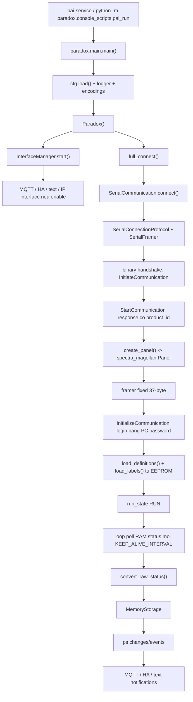

# SP/MG Serial Native Flow - SP4000, MG5000/MG5050, SP6000/SP6000+

Tai lieu nay chi tap trung vao dong Paradox Spectra/Magellan chay qua
`CONNECTION_TYPE = "Serial"`. Khong ban IP150, PRT3, EVO tru khi can so sanh
de tranh nham flow.

File code chinh:

- `paradox/main.py`: entrypoint runtime.
- `paradox/paradox.py`: coordinator ket noi, poll status, event, command.
- `paradox/connections/serial/*`: mo serial port, framer, optional serial encryption.
- `paradox/hardware/__init__.py`: map `product_id` sang panel adapter.
- `paradox/hardware/spectra_magellan/*`: parser, panel logic, event map, property map.
- `paradox/parsers/status.py`: doi raw status thanh structure theo element.
- `paradox/data/*`: storage RAM noi bo va change notification.
- `paradox/interfaces/mqtt/*`: publish MQTT, Home Assistant discovery, command subscribe.

## 1. Pham vi panel

Trong code, cac product id sau deu di vao cung mot adapter
`paradox.hardware.spectra_magellan.Panel`:

| Product id | Y nghia |
|---|---|
| `SPECTRA_SP4000` | Spectra SP4000 |
| `SPECTRA_SP5500` | Spectra SP5500 |
| `SPECTRA_SP550_PLUS` | Spectra SP550+ |
| `SPECTRA_SP6000` | Spectra SP6000 |
| `SPECTRA_SP6000_PLUS` | Spectra SP6000+ |
| `SPECTRA_SP7000` | Spectra SP7000 |
| `SPECTRA_SP7000_PLUS` | Spectra SP7000+ |
| `SPECTRA_SP65` | Spectra SP65 |
| `MAGELLAN_MG5000` | Magellan MG5000 |
| `MAGELLAN_MG5050` | Magellan MG5050 |
| `MAGELLAN_MG5050_PLUS` | Magellan MG5050+ |
| `MAGELLAN_MG5075` | Magellan MG5075 |

Neu ban noi "5000" thi trong repo thuong la Magellan `MG5000/MG5050`, con
Spectra co `SP5500`.

Adapter SP/MG dung chung memory map, parser status, parser event va command map.
Khac biet runtime dang chu y nhat la:

- `product_id` va firmware tra ve tu panel trong handshake.
- `supports_pgm_status = firmware.version >= 6`. Neu firmware major < 6 thi block
  RAM `7` khong duoc poll, nen khong co `pgm_status/on`.
- So zone/partition thuc te bi gioi han boi definition doc tu EEPROM va
  `cfg.LIMITS`.

## 2. Ket noi vat ly va config

README cua repo noi SP/MG/EVO co serial port tren panel, TTL 5V, hoac dung module
USB 307. Khi dung serial native, PAI noi truc tiep vao cong serial cua panel, sau
do giao tiep bang binary protocol Paradox.

Config toi thieu:

```python
CONNECTION_TYPE = "Serial"
SERIAL_PORT = "/dev/ttyUSB0"   # Linux USB serial, hoac COM3 tren Windows
SERIAL_BAUD = 9600             # MG/SP thuong 9600
SERIAL_ENCRYPTED = False       # SP/MG flow binh thuong de False
PASSWORD = "0000"              # PC password, 4 hex digit

KEEP_ALIVE_INTERVAL = 10       # moi 10s poll status mot lan
IO_TIMEOUT = 0.5               # timeout mot request/reply
LABEL_ENCODING = "paradox-en"

MQTT_ENABLE = True
MQTT_HOST = "127.0.0.1"
MQTT_PORT = 1883
```

PC password la password BabyWare/PC Communication cua panel. Trong code:

- `PASSWORD = "1234"` duoc encode thanh bytes `0x12 0x34`.
- `PASSWORD = None` bi encode thanh `0x00 0x00`.

Neu dung Linux service, tai khoan chay PAI phai co quyen read/write vao serial
device, vi `SerialCommunication.connect()` check `os.access(port, R_OK | W_OK)`
truoc khi mo port.

## 3. Kien truc chay tong the



Nguyen tac chia lop:

- `connections/serial`: chi xu ly byte stream, frame length, checksum, write/read.
- `hardware/spectra_magellan`: hieu protocol SP/MG, build command, parse status/event.
- `paradox.py`: dieu phoi session, retry, poll, dispatch, control command.
- `data`: giu trang thai hien tai cua panel trong RAM.
- `interfaces`: expose ra MQTT/Home Assistant/text/IP.

## 4. Serial framer cho SP/MG

Native serial SP/MG la binary frame co checksum cuoi frame.

Luc moi ket noi, PAI chua biet panel la EVO hay SP/MG, nen framer ban dau chay
variable-length. Sau `StartCommunication`, neu `product_id` thuoc SP/MG,
`create_panel()` tra ve `spectra_magellan.Panel(..., variable_message_length=False)`.
`Paradox.connect()` day flag nay xuong serial protocol:

```text
connection.variable_message_length(False)
```

Tu luc nay SP/MG dung fixed 37-byte frame. Day la diem quan trong:

- SP/MG reply/status/event binh thuong la 37 byte.
- Neu stream bi mat 1 byte, framer can resync bang checksum.
- Code co clamp length de tranh byte payload nhu battery voltage `0xC0-0xCF`
  bi hieu nham thanh length cuc lon va lam treo parser.

Khi raw bytes vao:

```text
serial port bytes
-> SerialConnectionProtocol.data_received()
-> SerialFramer.feed()
-> checksum ok
-> handler.on_message(frame.data)
-> Paradox.on_connection_message()
-> panel.parse_message(direction="frompanel")
```

Neu `LOGGING_DUMP_PACKETS=True`, log se co raw hex `PAI -> SER` va `SER -> PAI`.

## 5. Step by step luc khoi dong

### Step 1 - Start process

Chay:

```bash
pai-service -c /etc/pai/pai.conf
```

Hoac trong repo:

```bash
python -m paradox.console_scripts.pai_run -c config/pai.conf.example
```

`paradox.main.main()` lam cac viec:

1. Load config.
2. Cau hinh logger.
3. Dang ky label encoding `paradox-*`.
4. Tao `Paradox()`.
5. Tao `InterfaceManager` va start interface duoc enable.
6. Vao reconnect loop: `full_connect()` roi `loop()`.

### Step 2 - Mo serial port

`Paradox.connection` thay `cfg.CONNECTION_TYPE == "Serial"` nen tao:

```text
SerialCommunication(port=cfg.SERIAL_PORT, baud=cfg.SERIAL_BAUD)
```

`SerialCommunication.connect()`:

1. Log `Connecting to serial port ...`.
2. Check port readable/writable.
3. Tao `connected_future`.
4. Dat open timeout 5s.
5. Goi `serial_asyncio.create_serial_connection(...)`.
6. Khi port open, `SerialConnectionProtocol.connection_made()` goi
   `SerialCommunication.on_connection()`.
7. Set `connected=True`.

Neu port sai, khong co quyen, sai device path, hoac port khong mo duoc thi ket noi
fail truoc khi handshake panel.

### Step 3 - Dang ky handler

Khi connection object duoc tao, `_register_connection_handlers()` dang ky:

- Raw handler: `Paradox.on_connection_message`.
- Event handler: `Paradox.handle_event_message`, nhan frame live event command `0xE`.
- Error handler: `Paradox.handle_error_message`, nhan error command `0x7`.

`send_wait()` sau nay se dang ky temporary `FutureHandler` de doi reply dung dieu kien.

### Step 4 - Generic `InitiateCommunication`

Tai thoi diem nay PAI chua biet panel la SP/MG hay EVO. No tao generic
`hardware.Panel` va gui parser chung:

```text
PAI -> panel: InitiateCommunication
command: 0x72 0x00
reply_expected: command 0x7
```

Panel tra ve `InitiateCommunicationResponse`:

```text
panel -> PAI: command 0x72, new_protocol 0xFF
fields:
  protocol_id
  protocol.version/revision/build
  family_id
  product_id
  application.version/revision/build
  serial_number
  hardware.version/revision
  bootloader.version/revision/build/day/month/year
  processor_id
  encryption_id
  label
```

PAI lay:

- `model = label.strip(...)`
- `firmware_version = application.version.application.revision build ...`
- `serial_number = hex(serial_number)`

Day moi la detect so bo de biet panel dang noi chuyen.

### Step 5 - `StartCommunication`

Sau do PAI gui:

```text
PAI -> panel: StartCommunication
command: 0x5F
args:
  source_id = 0x2
reply_expected: command 0x0
```

Panel tra ve `StartCommunicationResponse`:

```text
fields:
  po.command = 0
  po.status:
    reserved
    alarm_reporting_pending
    Winload_connected
    NeWare_connected
  product_id
  firmware.version/revision/build
  panel_id
  transceiver.firmware_build/family/version/revision/noise_floor/status/hardware_revision
```

`product_id` o day la gia tri quyet dinh adapter. Neu la
`SPECTRA_SP4000`, `SPECTRA_SP6000`, `SPECTRA_SP6000_PLUS`, `MAGELLAN_MG5000`,
`MAGELLAN_MG5050`, ... thi:

```text
create_panel() -> paradox.hardware.spectra_magellan.Panel
```

Ngay sau do:

```text
connection.variable_message_length(False)
```

Tu day parser serial chuyen sang fixed 37-byte framing cho SP/MG.

### Step 6 - Login PC password bang `InitializeCommunication`

Sau khi co SP/MG panel adapter, `Panel.initialize_communication(cfg.PASSWORD)` chay.

PAI build `InitializeCommunication`:

```text
PAI -> panel: command 0x00
packet length: 37 bytes
fields:
  product_id = product_id vua detect
  firmware = firmware vua detect
  panel_id = panel_id vua detect
  pc_password = PASSWORD encode hex, vi du "1234" -> 0x12 0x34
  user_code = 0x000000
  _not_used1 = 0x19
  source_id = 0x02
```

PAI doi mot trong cac reply command:

```text
0x10: InitializeCommunicationResponse -> Authentication Success
0x70: CloseConnection -> Authentication Failed, thuong sai PASSWORD
0x00: cung duoc code coi la authentication failed
```

`InitializeCommunicationResponse` co:

```text
fields:
  po.command = 0x10
  neware_connection
  user_id_low
  partition_rights.partition_1
  partition_rights.partition_2
```

Neu thanh cong, `Paradox.run_state = CONNECTED`.

### Step 7 - Load definitions tu EEPROM

`full_connect()` goi `panel.load_memory()`.

`load_definitions()` doc definition cua zone va PGM tu EEPROM:

| Element | EEPROM address | Moi item | Parser |
|---|---:|---:|---|
| zone | `0x730` den `<0x7A0`, step `0x03` | 3 bytes | zone definition |
| pgm | `0x7A0` den `<0x800`, step `0x06` | 6 bytes | PGM definition |

Cach doc:

```text
PAI -> panel: ReadEEPROM command 0x50, address=<EEPROM address>
panel -> PAI: ReadEEPROMResponse command 0x5, address=<same>, data=32 bytes
```

Voi zone definition, parser tra:

```python
{
  "definition": "delay_1" | "instant" | "disabled" | ...,
  "partition": <int>,
  "options": {
    "auto_zone_shutdown": bool,
    "bypassable": bool,
    "rf_supervision": bool,
    "alarm_type": "audible_alarm_steady" | "silent_alarm" | "audible_alarm_pulse" | "report_only",
    "intellizone": bool,
    "delay_alarm_transmission": bool,
    "force_arming": bool,
  }
}
```

Voi PGM definition, parser tra:

```python
{
  "definition": {
    "activation": <PGMEvent enum hoac "disabled"/"unknown">,
    "deactivation": <PGMEvent enum hoac "disabled"/"unknown">,
  }
}
```

Definition nao khac `"disabled"` duoc tinh la enabled. Sau khi load xong,
`cfg.LIMITS[element_type]` duoc cap nhat de chi monitor element enabled, tru khi
config da gioi han cu the.

Event noi bo:

```text
ps.sendMessage("definitions_loaded", data=definitions)
Paradox._on_definitions_load() -> storage deep_merge
```

### Step 8 - Load labels tu EEPROM

Labels la ten zone/partition/user/PGM tren panel. Memory map:

| Element | EEPROM address | So label toi da theo map | Moi label |
|---|---:|---:|---:|
| zone | `0x010` den `<0x210` | 32 | 16 bytes |
| pgm | `0x210` den `<0x310` | 16 | 16 bytes |
| partition | `0x310` den `<0x330` | 2 | 16 bytes |
| user | `0x330` den `<0x530` | 32 | 16 bytes |
| module | `0x530` den `<0x620` | 15 | 16 bytes |
| repeater | `0x620` den `<0x640` | 2 | 16 bytes |
| keypad | `0x640` den `<0x6C0` | 8 | 16 bytes |
| site | `0x6C0` den `<0x6D0` | 1 | 16 bytes |
| siren | `0x6D0` den `<0x700` | 3 | 16 bytes |

Moi `ReadEEPROMResponse` co `data=32 bytes`, nen voi label 16 byte thi mot read
thuong lay duoc 2 label lien tiep.

Moi label duoc decode bang `cfg.LABEL_ENCODING`, default `paradox-en`.
Sau decode, object trong storage co dang:

```python
{
  "id": 1,
  "key": "front_door",  # sanitize tu label
  "label": "Front Door"
}
```

Voi PGM, template them:

```python
{
  "on": False,
  "pulse": False
}
```

Event noi bo:

```text
ps.sendMessage("labels_loaded", data=labels)
Paradox._on_labels_load() -> storage deep_merge
```

Sau do MQTT/HA co the dung label/key de tao topic/entity.

### Step 9 - Vao RUN va trigger status dau tien

Sau memory load:

```text
Paradox.run_state = RUN
Paradox.request_status_refresh()
ps.sendMessage("connected")
```

`request_status_refresh()` set event de loop poll status ngay, khong can doi het
`KEEP_ALIVE_INTERVAL`.

## 6. Poll status: doc cai gi, nhan cai gi

Trong SP/MG, status duoc doc bang `ReadEEPROM` toi vung RAM bat dau `0x8000`.
Moi block tra ve 32 byte data.

`Panel.status_request_addresses` lay keys cua `RAMDataParserMap`:

```text
[0, 1, 2, 3, 4, 5, 7] neu firmware.version >= 6
[0, 1, 2, 3, 4, 5] neu firmware.version < 6
```

Voi tung block `i`, code gui:

```text
PAI -> panel:
  ReadEEPROM command 0x50
  address = 0x8000 + i

panel -> PAI:
  ReadStatusResponse command nibble 0x5
  validation = 0x80
  address = i
  data = 32 bytes
```

Reply check bat buoc:

```text
m.fields.value.po.command == 0x5
m.fields.value.address == i
```

Neu khong co reply, `StatusRequestException` duoc raise. Qua 3 lan missing lien
tiep, PAI coi la mat lien lac panel va disconnect/reconnect.

## 7. RAM status block chi tiet

### Block 0 - troubles, system, zone open/tamper/fire

Doc:

```text
ReadEEPROM address = 0x8000
ReadStatusResponse address = 0
```

Parser tra:

```python
{
  "troubles": {
    "timer_loss_trouble": bool,
    "fire_loop_trouble": bool,
    "module_tamper_trouble": bool,
    "zone_tamper_trouble": bool,
    "communication_trouble": bool,
    "bell_trouble": bool,
    "power_trouble": bool,
    "rf_low_battery_trouble": bool,
    "rf_interference_trouble": bool,
    "module_supervision_trouble": bool,
    "zone_supervision_trouble": bool,
    "wireless_repeater_battery_trouble": bool,
    "wireless_repeater_ac_loss_trouble": bool,
    "wireless_keypad_battery_trouble": bool,
    "wireless_keypad_ac_trouble": bool,
    "auxiliary_output_overload_trouble": bool,
    "ac_failure_trouble": bool,
    "low_battery_trouble": bool,
    "bell_output_overload_trouble": bool,
    "bell_output_disconnected_trouble": bool,
    "computer_fail_to_communicate_trouble": bool,
    "voice_fail_to_communicate_trouble": bool,
    "pager_fail_to_communicate_trouble": bool,
    "central_2_reporting_ftc_indicator_trouble": bool,
    "central_1_reporting_ftc_indicator_trouble": bool,
    "telephone_line": bool,
  },
  "system": {
    "date": {"time": datetime},
    "power": {"vdc": float, "battery": float, "dc": float},
    "rf": {"noise_floor": int},
  },
  "zone_open": {1: bool, ..., 32: bool},
  "zone_tamper": {1: bool, ..., 32: bool},
  "pgm_tamper": {1: bool, ..., 16: bool},
  "module_tamper": {1: bool, ..., 16: bool},
  "zone_fire": {1: bool, ..., 32: bool},
}
```

Sau `convert_raw_status()`:

```python
status["zone"][1]["open"] = True/False
status["zone"][1]["tamper"] = True/False
status["zone"][1]["fire"] = True/False
status["pgm"][1]["tamper"] = True/False
status["module"][1]["tamper"] = True/False
status["system"]["power"]["battery"] = 12.8
status["system"]["date"]["time"] = datetime(...)
status["troubles"]["ac_failure_trouble"] = True/False
```

### Block 1 - RF supervision, partition status, repeater/keypad trouble

Doc:

```text
ReadEEPROM address = 0x8001
ReadStatusResponse address = 1
```

Parser tra:

```python
{
  "zone_rf_supervision_trouble": {1: bool, ..., 32: bool},
  "pgm_supervision_trouble": {1: bool, ..., 16: bool},
  "module_supervision_trouble": {1: bool, ..., 16: bool},
  "repeater_supervision_trouble": {1: bool, ..., 8: bool},
  "zone_rf_low_battery_trouble": {1: bool, ..., 32: bool},
  "partition_status": {
    1: {
      "alarm": bool,
      "pulse_fire_alarm": bool,
      "audible_alarm": bool,
      "silent_alarm": bool,
      "strobe_alarm": bool,
      "arm_stay": bool,
      "arm_sleep": bool,
      "arm": bool,
      "bell_activated": bool,
      "auto_arming_engaged": bool,
      "recent_closing_delay": bool,
      "intellizone_delay": bool,
      "zone_bypassed": bool,
      "alarms_in_memory": bool,
      "entry_delay": bool,
      "exit_delay": bool,
      "paramedic_alarm": bool,
      "arm_with_remote": bool,
      "transmission_delay_finished": bool,
      "bell_delay_finished": bool,
      "entry_delay_finished": bool,
      "exit_delay_finished": bool,
      "intellizone_delay_finished": bool,
      "wait_window": bool,
      "in_remote_delay": bool,
      "stayd_mode_active": bool,
      "arm_force": bool,
      "ready_status": bool,
    },
    2: {...}
  },
  "repeater_ac_loss_trouble": {1: bool, ..., 8: bool},
  "repeater_battery_failure_trouble": {1: bool, ..., 8: bool},
  "keypad_ac_loss_trouble": {1: bool, ..., 8: bool},
  "keypad_battery_failure_trouble": {1: bool, ..., 8: bool},
  "keypad_supervision_failure_trouble": {1: bool, ..., 8: bool},
}
```

Sau convert:

```python
status["partition"][1]["arm"] = True/False
status["partition"][1]["exit_delay"] = True/False
status["partition"][1]["ready_status"] = True/False
status["zone"][1]["rf_supervision_trouble"] = True/False
status["zone"][1]["rf_low_battery_trouble"] = True/False
status["keypad"][1]["battery_failure_trouble"] = True/False
status["repeater"][1]["ac_loss_trouble"] = True/False
```

Area/partition trong SP/MG code la `partition`, toi da 2 theo parser nay.
Home Assistant se hien partition thanh alarm panel entity neu co label.

### Block 2 - zone_status chi tiet

Doc:

```text
ReadEEPROM address = 0x8002
ReadStatusResponse address = 2
```

Parser tra `zone_status` cho zone 1..32:

```python
{
  1: {
    "was_in_alarm": bool,
    "alarm": bool,
    "fire_delay": bool,
    "entry_delay": bool,
    "intellizone_delay": bool,
    "no_delay": bool,
    "bypassed": bool,
    "shutdown": bool,
    "in_tx_delay": bool,
    "was_bypassed": bool,
  },
  ...
}
```

Sau convert:

```python
status["zone"][1]["alarm"] = True/False
status["zone"][1]["bypassed"] = True/False
status["zone"][1]["entry_delay"] = True/False
```

### Block 3 - zone signal strength

Doc:

```text
ReadEEPROM address = 0x8003
ReadStatusResponse address = 3
```

Parser tra:

```python
{"zone_signal_strength": {1: int, ..., 32: int}}
```

Sau convert:

```python
status["zone"][1]["signal_strength"] = 0..255
```

### Block 4 - PGM/repeater/keypad signal strength

Doc:

```text
ReadEEPROM address = 0x8004
ReadStatusResponse address = 4
```

Parser tra:

```python
{
  "pgm_signal_strength": {1: int, ..., 16: int},
  "repeater_signal_strength": {1: int, 2: int},
  "keypad_signal_strength": {1: int, ..., 8: int},
}
```

Sau convert:

```python
status["pgm"][1]["signal_strength"] = int
status["repeater"][1]["signal_strength"] = int
status["keypad"][1]["signal_strength"] = int
```

### Block 5 - zone exit delay

Doc:

```text
ReadEEPROM address = 0x8005
ReadStatusResponse address = 5
```

Parser tra:

```python
{"zone_exit_delay": {1: bool, ..., 32: bool}}
```

Sau convert:

```python
status["zone"][1]["exit_delay"] = True/False
```

### Block 7 - PGM on/off, firmware >= 6

Doc:

```text
ReadEEPROM address = 0x8007
ReadStatusResponse address = 7
```

Chi poll neu:

```python
self.settings.firmware.version >= 6
```

Parser tra:

```python
{
  "pgm_status": {
    1: {"on": bool},
    ...
    32: {"on": bool},
  }
}
```

Sau convert:

```python
status["pgm"][1]["on"] = True/False
```

Neu firmware < 6, PAI khong co du lieu `pgm/on` tu polling. Khi control output,
co the van gui command, nhung trang thai PGM co the khong duoc confirm bang block 7.

## 8. Tu raw status den storage va MQTT

Sau khi poll cac block:

1. `asyncio.gather(*panel.get_status_requests())` nhan list dict raw.
2. `deep_merge()` gop block 0,1,2,3,4,5,7.
3. `_process_status()` goi `convert_raw_status(raw_status)`.
4. `convert_raw_status()` doi ten root key thanh element/property:
   - `zone_open` -> `status["zone"][id]["open"]`
   - `zone_tamper` -> `status["zone"][id]["tamper"]`
   - `partition_status` -> `status["partition"][id]`
   - `pgm_status` -> `status["pgm"][id]`
   - `system` -> `status["system"]`
   - `troubles` -> `status["troubles"]`
5. Ap dung `cfg.LIMITS`.
6. Publish noi bo `ps.sendMessage("status_update", status=status)`.
7. `_on_status_update()` update `MemoryStorage`.
8. Moi property doi tao `Change`.
9. `_on_property_change()` bien `Change` thanh `ChangeEvent` neu property co trong
   `property_map`.
10. Interface MQTT/text/HA nhan change/event va publish ra ngoai.

Vi du status normalized:

```python
{
  "partition": {
    1: {
      "arm": False,
      "arm_stay": False,
      "arm_sleep": False,
      "exit_delay": False,
      "entry_delay": False,
      "ready_status": True,
      "alarm": False,
    }
  },
  "zone": {
    1: {
      "open": True,
      "tamper": False,
      "alarm": False,
      "bypassed": False,
      "signal_strength": 80,
    }
  },
  "system": {
    "power": {"vdc": 16.5, "battery": 13.4, "dc": 13.5},
    "date": {"time": datetime(...)}
  },
  "troubles": {
    "ac_failure_trouble": False,
    "low_battery_trouble": False,
  }
}
```

MQTT state topic mac dinh:

```text
paradox/states/partitions/<partition_key>/<property>
paradox/states/zones/<zone_key>/<property>
paradox/states/outputs/<pgm_key>/<property>
paradox/states/system/<system_key>/<property>
```

Vi du:

```text
paradox/states/zones/front_door/open = True
paradox/states/zones/front_door/tamper = False
paradox/states/partitions/home/current_state = disarmed
paradox/states/partitions/home/ready_status = True
paradox/states/system/power/battery = 13.4
paradox/states/system/troubles/ac_failure_trouble = False
```

Neu `MQTT_USE_NUMERIC_STATES=True`, boolean co the publish thanh `0/1`. Mac dinh
la string `"True"`/`"False"`.

## 9. Partition/area state cua Home Assistant

SP/MG parser dung tu `partition`. Neu ban quen goi la `area`, o day co the hieu:

```text
area 1 == partition 1
area 2 == partition 2
```

`_update_partition_states()` tao property synthetic:

```python
current_state
target_state
```

Logic hien tai:

1. Neu partition co `fire_alarm`, `audible_alarm`, `silent_alarm`, hoac
   `panic_alarm` -> `current_state = "triggered"`.
2. Neu `arm=True`:
   - `arm_stay=True` -> `armed_home`.
   - `arm_sleep=True` hoac `arm_no_entry=True` -> `armed_night`.
   - `arm_away=True` -> `armed_away`.
   - fallback cung la `armed_away`.
   - `target_state` bang current armed state.
3. Neu `arm=False` -> `current_state = target_state = "disarmed"`.
4. Neu `exit_delay=True` -> override `current_state = "arming"`.

Luu y quan trong: trong code hien tai, `entry_delay=True` khong override
`current_state` thanh `"pending"`. Property map co message entry delay, nhung
state HA synthetic chi override theo `exit_delay`.

## 10. Live event: khi nao tra ra, tra ra cai gi

Live event la frame bat dong bo tu panel. No khong can PAI poll. Khi co su kien
thuc te tren tu nhu zone open, arm, disarm, alarm, tamper, trouble, panel gui
frame command nibble `0xE`.

Parser `LiveEvent` tra:

```python
{
  "po": {
    "command": 0xE,
    "status": {
      "reserved": bool,
      "alarm_reporting_pending": bool,
      "Winload_connected": bool,
      "NeWare_connected": bool,
    }
  },
  "time": datetime(...),
  "event": {"major": int, "minor": int},
  "partition": int,       # byte raw + 1
  "module_serial": str,
  "label": bytes(16),
}
```

`Paradox.handle_event_message()`:

1. Tao `LiveEvent(raw, panel.event_map, label_provider=self.get_label)`.
2. Tim element trong storage theo `evt.type` va `evt.id`.
3. Neu event co `change` va element ton tai, update storage.
4. Publish noi bo `ps.sendEvent(evt)`.
5. `_on_event()` goi hook neu event co hook va update partition state.

Mot so `event_map` SP/MG quan trong:

| Major | Minor | Nghia chinh | Storage change |
|---:|---:|---|---|
| 0 | any | Zone OK | `zone.open=False` |
| 1 | any | Zone open | `zone.open=True` |
| 2 | 2 | Partition silent alarm active | `partition.silent_alarm=True`, `alarm=True` |
| 2 | 3/4/5 | Audible alarm active | `partition.audible_alarm=True`, `alarm=True` |
| 2 | 7 | Partition alarm stopped | `partition.alarm=False` |
| 2 | 11 | Partition disarmed | `arm=False`, `arm_sleep=False`, `arm_stay=False`, `alarm=False` |
| 2 | 12 | Partition armed | `arm=True` |
| 2 | 13 | Entry delay | `entry_delay=True` |
| 2 | 14 | Exit delay | `exit_delay=True` |
| 6 | 3 | Stay arm | `arm_stay=True`, `arm=True` |
| 6 | 4 | Sleep arm | `arm_sleep=True`, `arm=True` |
| 6 | 5 | Force arm | `arm_force=True`, `arm=True` |
| 29 | any | Arming by user | event only |
| 31 | any | Disarming by user | event only |
| 32 | any | Disarming after alarm by user | event only |
| 35 | any | Zone bypass toggled | `zone.bypassed = not old` |
| 36 | any | Zone in alarm | `zone.alarm=True` |
| 37 | any | Zone fire alarm | `zone.fire_alarm=True` |
| 38 | any | Zone alarm restore | `zone.alarm=False` |
| 39 | any | Zone fire restore | `zone.fire_alarm=False` |
| 42 | any | Zone tamper | `zone.zone_tamper_trouble=True` |
| 43 | any | Zone tamper restore | `zone.zone_tamper_trouble=False` |
| 44 | any | New trouble | trouble event |
| 45 | any | Trouble restored | restore event |

Neu `MQTT_PUBLISH_RAW_EVENTS=True`, MQTT publish event props vao:

```text
paradox/events/raw
```

Payload la JSON cua event, gom cac truong nhu:

```json
{
  "type": "partition",
  "id": 1,
  "label": "Home",
  "major": 2,
  "minor": 12,
  "message": "Partition Home armed",
  "level": "INFO",
  "tags": ["arm"],
  "change": {"arm": true}
}
```

Exact key co the khac tuy `Event.props`, nhung y nghia la event da duoc map tu
`major/minor` sang message, type, id, tags va change.

## 11. Command flow: MQTT/text di nguoc ve panel

MQTT command vao:

```text
paradox/control/partitions/<partition_key>
paradox/control/zones/<zone_key>
paradox/control/outputs/<pgm_key>
paradox/panic/<panic_type>/<partition>
```

`BasicMQTTInterface` parse command, roi goi `Paradox.control_*()`.
Core chon element bang numeric id hoac `key` trong storage, sau do goi
`panel.control_*()`.

### Partition command

Payload hop le theo SP/MG code:

| MQTT/text command | PerformAction action | Argument |
|---|---:|---|
| `arm` | `0x04` Full_Arm | `partition - 1` |
| `disarm` | `0x05` Disarm | `partition - 1` |
| `arm_stay` | `0x01` Stay_Arm | `partition - 1` |
| `arm_force` | `0x02` Stay_Arm1/force-like map | `partition - 1` |
| `arm_sleep` | `0x03` Sleep_Arm | `partition - 1` |
| `arm_stay_stayd` | `0x06` | `partition - 1` |
| `arm_sleep_stay` | `0x07` | `partition - 1` |
| `disarm_all` | `0x08` | `partition - 1` |

Wire flow:

```text
MQTT publish paradox/control/partitions/home = arm
-> BasicMQTTInterface._mqtt_handle_partition_control()
-> Paradox.control_partition("home", "arm")
-> storage.partition.select("home") -> [1]
-> Panel.control_partitions([1], "arm")
-> Send PerformAction command 0x40:
     action = 0x04
     argument = 0
-> wait PerformActionResponse command 0x4
-> accepted=True neu co reply
-> request_status_refresh()
-> status poll/event cap nhat storage
-> MQTT publish state moi
```

Command accepted chi nghia la panel tra response `0x4`, khong phai moi property
da duoc poll lai ngay lap tuc. Sau command, PAI trigger poll status som de confirm.

### Zone command

Payload:

| Command | Action | Argument |
|---|---:|---|
| `bypass` | `0x10` | `zone - 1` |
| `clear_bypass` | `0x10` | `zone - 1` |

Luu y code map ca `bypass` va `clear_bypass` cung `0x10`. Thuc te no hoat dong
nhu action bypass/toggle theo protocol/panel behavior, khong phai hai opcode rieng.
Can confirm tren panel that neu can dam bao semantics clear.

### PGM/output command

Payload:

| Command | Action |
|---|---:|
| `on_override` | `0x30` |
| `off_override` | `0x31` |
| `on` | `0x32` |
| `off` | `0x33` |
| `pulse` | gui `on`, sleep `OUTPUT_PULSE_DURATION`, roi gui `off` |

Flow:

```text
MQTT publish paradox/control/outputs/siren = on
-> Paradox.control_output("siren", "on")
-> storage.pgm.select("siren") -> [pgm_id]
-> Panel.control_outputs([pgm_id], "on")
-> PerformAction 0x40 action=0x32 argument=pgm_id-1
-> PerformActionResponse 0x4
```

Neu firmware >= 6, status block 7 se confirm lai `pgm.on`. Neu firmware < 6,
khong co block 7 nen MQTT state `on` co the khong duoc update tu poll status.

### Panic command

MQTT topic:

```text
paradox/panic/<panic_type>/<partition>
```

Payload la user id/key. Core yeu cau ca partition va user ton tai trong storage.

Panel gui `SendPanicAction`:

```text
command 0x40
unknown0 = 0x1A
partition
panic_type = emergency | medical | fire
user_id
```

Trong parser co comment "Supported on firmware versions 7.15+". Nen voi SP/MG
firmware cu, can test tren panel that truoc khi phu thuoc vao panic command.

### Door va module PGM

`spectra_magellan.Panel` khong implement `control_doors()` va
`control_module_pgm_outputs()`. Goi cac lenh nay se roi vao base method va bi
core log warning `not implemented`.

## 12. Khi nao data duoc tra ra

Co 4 thoi diem chinh:

1. **Trong handshake**:
   - `InitiateCommunicationResponse` tra protocol/product/model/firmware/serial.
   - `StartCommunicationResponse` tra product_id, firmware, panel_id.
   - `InitializeCommunicationResponse` tra ket qua login va partition rights.
2. **Trong memory load**:
   - `ReadEEPROMResponse` tra labels va definitions, 32 bytes moi request.
   - Chi chay luc connect/reconnect hoac khi code goi load memory.
3. **Trong status poll**:
   - `ReadStatusResponse` tra RAM block 0/1/2/3/4/5/7.
   - Chay ngay sau connect, sau command, va moi `KEEP_ALIVE_INTERVAL`.
4. **Trong live event**:
   - `LiveEvent` command `0xE` den bat cu luc nao khi panel phat sinh event.
   - Khong doi poll.

## 13. Data nao duoc publish ra Home Assistant

Home Assistant autodiscovery chi publish sau khi co du:

1. MQTT connected.
2. `panel_detected`.
3. `status_update` dau tien.

Entity chinh:

- `alarm_control_panel`: moi partition co label.
- `binary_sensor`: zone properties trong `HOMEASSISTANT_PUBLISH_ZONE_PROPERTIES`,
  default `open`, `tamper`.
- `binary_sensor` partition properties trong
  `HOMEASSISTANT_PUBLISH_PARTITION_PROPERTIES`, default `target_state`,
  `current_state` trong config mau nhung binary sensor voi non-bool co the khong
  phai entity dep nhat.
- `switch`: zone bypass neu property `bypassed` duoc publish.
- `switch`: PGM neu co PGM status.
- system sensors/binary_sensors tu status system/troubles.

Alarm panel command topic:

```text
paradox/control/partitions/<partition_key>
```

Alarm panel state topic:

```text
paradox/states/partitions/<partition_key>/current_state
```

Payload HA:

```text
disarmed
arming
armed_home
armed_away
armed_night
triggered
```

`pending` co trong property map message nhung code hien tai khong set tu
`entry_delay`.

## 14. Loi thuong gap theo flow

### Khong mo duoc serial

Kiem:

- `SERIAL_PORT` dung chua.
- User co quyen read/write serial device chua.
- Baud dung chua, SP/MG thuong `9600`.
- Co process khac dang chiem port khong.

Log thuong nam o step `Connecting to serial port ...`.

### Co raw bytes nhung khong parse duoc

Kiem:

- `CONNECTION_TYPE="Serial"` co dung khong.
- Sau detect SP/MG, framer da set fixed 37-byte chua.
- `LOGGING_DUMP_PACKETS=True` de xem raw frame.
- Sai baud se tao byte rac, checksum mismatch/resync lien tuc.

### Timeout handshake

Kiem:

- Day serial TTL dung chieu TX/RX/GND chua.
- Level 5V TTL dung chua.
- Panel co dang bi BabyWare/WinLoad ket noi doc quyen khong.
- `PASSWORD` khong anh huong step generic handshake, chi anh huong installer login.

### Authentication failed

Neu login tra `0x70` hoac error invalid PC password:

- Kiem `PASSWORD`.
- Password phai la PC Communication password, khong phai user code keypad.
- Format `"1234"` se thanh bytes `0x12 0x34`; dung ky tu hex.

### Co MQTT command accepted nhung state chua doi

Command accepted la co `PerformActionResponse`. State thuc te van den tu:

- live event panel phat ra, hoac
- status poll sau command.

Neu status block khong doi, can xem panel co chap nhan hanh dong that khong, partition
co ready khong, zone co open khong, user/PC permission co du khong.

### PGM khong co state on/off

Kiem firmware:

```python
supports_pgm_status = firmware.version >= 6
```

Neu firmware < 6, PAI khong poll block 7 nen khong co state `pgm.on` tu panel.

## 15. Debug dung thu tu nao

Khi loi thuc te, debug theo thu tu nay:

1. **Serial physical**: port, permission, baud, TX/RX/GND, adapter.
2. **Raw frame**: bat `LOGGING_DUMP_PACKETS`, xem co `SER -> PAI` khong.
3. **Framing/checksum**: co checksum mismatch/resync lien tuc khong.
4. **Handshake**: co `InitiateCommunicationResponse` va `StartCommunicationResponse` khong.
5. **Product id**: co roi vao `spectra_magellan.Panel` khong.
6. **Password**: `InitializeCommunicationResponse` co `0x10` khong.
7. **EEPROM labels/definitions**: co load label partition/zone khong.
8. **Status poll**: co `ReadStatusResponse address 0/1/2/3/4/5/7` khong.
9. **Storage**: `status_update` co cap nhat `MemoryStorage` khong.
10. **MQTT**: topic `paradox/states/...` co publish khong.
11. **HA**: discovery co du panel_detected + first_status_update chua.

Debug flags huu ich:

```python
LOGGING_LEVEL_CONSOLE = logging.DEBUG
LOGGING_DUMP_PACKETS = True
LOGGING_DUMP_MESSAGES = True
LOGGING_DUMP_STATUS = True
LOGGING_DUMP_EVENTS = True
```

Khong nen share log debug neu co password/user code nhay cam.

## 16. Tom tat ngan gon flow doc va flow ghi

Flow doc status:

```text
serial bytes
-> fixed 37-byte framer
-> panel.parse_message()
-> ReadStatusResponse
-> RAMDataParserMap block 0/1/2/3/4/5/7
-> convert_raw_status()
-> MemoryStorage
-> Change/ChangeEvent
-> MQTT/HA/text
```

Flow live event:

```text
panel event command 0xE
-> LiveEvent parser
-> event_map major/minor
-> optional storage change
-> ps.sendEvent()
-> MQTT raw event/text notification
-> update partition current_state neu can
```

Flow command:

```text
MQTT/text command
-> Paradox.control_partition/control_zone/control_output
-> select element by id/key from MemoryStorage
-> PerformAction command 0x40
-> PerformActionResponse command 0x4
-> request_status_refresh()
-> status/event confirms real state
```

Ket luan: voi SP4000/MG5000/MG5050/SP6000/SP6000+ qua serial native, PAI khong
co database va khong "doan" state. No doc EEPROM de biet element/label, poll RAM
block de lay status hien tai, nhan live event de cap nhat nhanh, roi publish state
qua MQTT/Home Assistant. Neu can debug, di tu byte serial -> parser -> status/event
-> storage -> MQTT, dung thu tu nay se ra dung diem bi dung.
